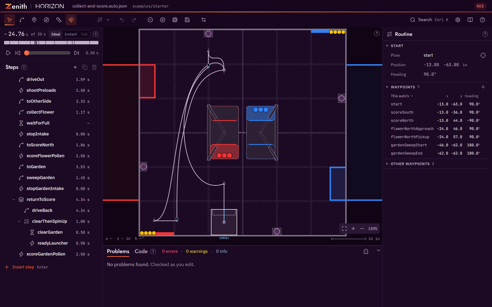

<h1>
  <picture>
    <source media="(prefers-color-scheme: dark)" srcset=".github/assets/wordmark-dark.svg">
    
  </picture>
</h1>

**Plan an FTC autonomous on the real field, see whether it will work, and run it on the robot without
editing Java.**

[](https://libraries.horizon36596.org/zenith/changelog/)
[](LICENSE)
[](https://libraries.horizon36596.org/zenith/)

Zenith is an autonomous path planner for FTC. You draw a routine on the field as
paths with headings, attach robot commands to points on those paths, and check the plan against the
field, period and robot limits in your files. AI agents edit the same files
through a CLI and an MCP server and get the same checks. Each routine is one readable JSON file in
your robot repository, and a small runtime on the robot plays it through Pedro Pathing v3 and
Ivy or SolversLib. Once that runtime and your named commands are set up, a new auto needs no Java edit.

Zenith also plans with your alliance partner. Load a partner's file next to your auto to see both
robots on one field and one clock, with predicted collisions and one-click fixes; declare the area a
step that paths on the fly from vision stays in; and suggest changes to a partner's auto as a file
they accept or reject change by change. Paths come in from Pedro Pathing Visualizer projects,
RoadRunner through MeepMeep, and two documented interchange files. A web app on the editor's allowed
list, such as the DSIM simulator, can open Zenith in a popup with its own robot project and take the
saved auto back.



Zenith is in beta. It works end to end, but file formats, command names and the editor layout may
still change before 1.0. Pin the version you use and read the [changelog](CHANGELOG.md) before you
upgrade.

## Start here

| | What it is | Where |
|---|---|---|
| **Desktop** | The Windows app. Opens a robot project folder in place, and adds the high-fidelity sim, deploy, commit and pull request buttons. | [GitHub Releases](https://github.com/Horizon-36596/zenith/releases) |
| **Web** | The same editor in a browser. Nothing to install; the example loads with one click. | [zenith.horizon36596.org](https://zenith.horizon36596.org/) |
| **Agents** | The `zenith` CLI and the `zenith-mcp` server, for Claude Code or any MCP client. | [Agents and MCP](https://libraries.horizon36596.org/zenith/agents-mcp/) |
| **Robot runtime** | The Java library that plays an auto file on the robot. | [Robot runtime](https://libraries.horizon36596.org/zenith/robot-runtime/) |

The documentation is at **<https://libraries.horizon36596.org/zenith/>**: getting started, the editor
guide, a newcomer's guide to autonomous paths, the file-format reference and the JSON Schemas, the
checks, the sims, alliance partners, imports from other planners, host mode, the CLI, agents and MCP,
seasons and the FAQ.

## Accounts, teams and sharing

Zenith works fully with no account. Optional accounts add a team library in the cloud and sharing
with other teams, encrypted end to end on your devices. They are in the published web app and the
desktop app: anyone can sign in with GitHub, Microsoft or Google and make or join a team.
[Teams and sharing](https://libraries.horizon36596.org/zenith/teams-and-sharing/) describes them, and
the [privacy notice](https://libraries.horizon36596.org/zenith/privacy/) says what the cloud holds.
A build from source has the cloud off unless it is given a Firebase config (`cloud/README.md`).

## Works with SimLoop

[SimLoop](https://github.com/Horizon-36596/simloop) is Horizon's library for running FTC robot code on a laptop: your subsystems and OpMode run against fake hardware in a JVM unit test. Zenith works with it. Zenith's high-fidelity sim runs your robot repository's own headless sim, and a SimLoop setup can be that sim. Zenith does not depend on SimLoop, and nothing in Zenith needs it to plan, check or preview an auto. SimLoop is an alpha, `v0.2.0-alpha.1`, under the BSD-3-Clause licence.

[Full sim with SimLoop](https://libraries.horizon36596.org/zenith/full-sim-simloop/) sets the two up
together, and the [SimLoop docs](https://libraries.horizon36596.org/simloop/) cover SimLoop itself.

## Install

The CLI and the MCP server, from npm:

```powershell
npm install --save-dev --save-exact @horizon36596/zenith-cli @horizon36596/zenith-mcp
```

Or point your MCP client at the server with no install, in `.mcp.json` at your robot repository's
root:

```json
{
  "mcpServers": {
    "zenith": { "command": "npx", "args": ["-y", "@horizon36596/zenith-mcp"] }
  }
}
```

The robot runtime, from JitPack, in `build.dependencies.gradle` at the root of your FTC project. It
runs on Ivy, Pedro Pathing's command library, or on SolversLib; both are first-class, and you declare
the one your robot code uses.

For Ivy:

```groovy
repositories {
    mavenCentral()
    maven { url = 'https://jitpack.io' }                                       // Zenith
    maven { url = 'https://central.sonatype.com/repository/maven-snapshots' }  // Pedro Pathing v3
}

dependencies {
    implementation 'com.pedropathing.ivy:pedro:1.1.1'
    implementation 'com.pedropathing:core:3.0.0-20260828.185437-17'
    implementation 'com.github.Horizon-36596:zenith:v0.1.2'
}
```

For SolversLib:

```groovy
repositories {
    maven { url = 'https://jitpack.io' }                                       // Zenith
    maven { url = 'https://repo.dairy.foundation/releases' }                   // SolversLib
    maven { url = 'https://central.sonatype.com/repository/maven-snapshots' }  // Pedro Pathing v3
}

dependencies {
    implementation 'org.solverslib:core:0.3.6'
    implementation 'com.pedropathing:core:3.0.0-20260828.185437-17'
    implementation 'com.github.Horizon-36596:zenith:v0.1.2'
}
```

Then name the same library in the `deploy` block of `zenith.json`, `"commandLibrary": "ivy"` or
`"commandLibrary": "solverslib"`. Zenith does not pick one, and writes no Java until it is set.
The [robot runtime page](https://libraries.horizon36596.org/zenith/robot-runtime/) covers the Pedro
and command library setup and deploying autos, and
[Choosing a command library](https://libraries.horizon36596.org/zenith/command-libraries/) says how to
choose and how to switch. The SolversLib runtime is the one tested most on a real robot.

## Build it yourself

You need Node 22 and pnpm 10.

```powershell
pnpm install; pnpm build; pnpm test
```

```powershell
pnpm --filter ./apps/web dev
```

[CONTRIBUTING.md](CONTRIBUTING.md) has the checks a change must pass and the rules the code depends
on.

## Licence

MIT, copyright Horizon (FTC 36596). You may use Zenith, change it and share it, including in your own
team's code and in commercial work. Keep the copyright notice and the licence text with any copy you
pass on. The full text is in [LICENSE](LICENSE).

## Credits

- The bundled fonts are Jost, IBM Plex Sans and JetBrains Mono, each under the SIL Open Font Licence
  1.1.
- Robot following is Pedro Pathing v3, and commands are Ivy, Pedro Pathing's command library, or
  SolversLib.

[NOTICE](NOTICE) lists every third-party credit and licence.

Zenith is built by Horizon (FTC 36596).
