# The editor

This page describes every part of the Zenith editor: the tools, the panels, the inspector, the canvas gestures and the keyboard shortcuts. The desktop app and the web app share the same editor; where one has something the other does not, this page says so.


## Layout

The window has one main region, the field, with panels round it:

```
┌ title bar ·········································································┐
│ toolbar: tools │ undo │ actions │ view                                            help │
├──────────────────┬──────────────────────────────────────────────┬──────────────────────┤
│ timeline         │                                              │ inspector            │
│ steps            │                  the field                   │                      │
│                  ├──────────────────────────────────────────────┤                      │
│ ledger (folded)  │ problems                                     │                      │
│ partners (folded)│                                              │                      │
└──────────────────┴──────────────────────────────────────────────┴──────────────────────┘
```

Every panel title and every inspector section has a small `?` next to it. Hover it, focus it with the keyboard, or click it to pin it open: it says in a sentence or two what that part is for. Some also have a **Show me** link that starts the tour at that feature. Click the `?` to pin it open: a pinned tip adds **Read more**, a link to the part of this guide that covers the same thing in full, which opens in a new tab. The hover tip is short on purpose and the detail lives here.

Panel edges can be dragged to resize the columns. `F6` moves keyboard focus from one region to the next.

### Narrow windows

Below 820 px wide, the Inspector opens over the right side of the field. Below 640 px, Steps opens
over the left side too. Use **Steps**, **Field** or **Inspector** in the bar below the toolbar to
choose what to show. Only one overlay opens at a time; choosing **Field**, or pressing the open
panel's button again, closes it. Widen the window to see the columns together.

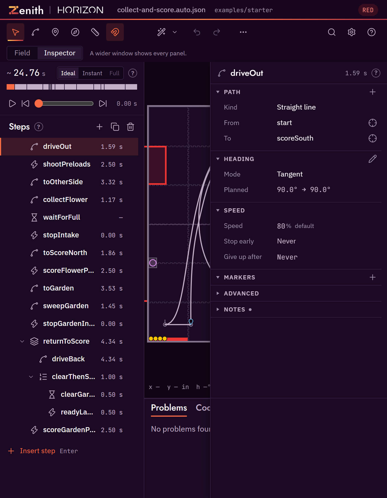

*At 700 px, Steps stays beside the field and Inspector opens over it.*

Pull-request reviews, proposals and library comparisons need at least 900 px to show their panels
side by side. They display a message when the window is too narrow.

## Title bar

The title bar shows the Horizon mark, the word Zenith, the name of the open auto, and the folder or GitHub repository and branch it came from. A dot after the name means there are unsaved changes. On the right is the alliance pill (RED or BLUE), and in the desktop app the window controls.

## Toolbar


The toolbar is one row of groups: the tools, Optimize path, Undo and Redo, the actions and the view. It never wraps, and no button moves when you pick a tool. Below 1100 px wide, Search shows its magnifier alone and the Documentation book goes (the help menu still has **Documentation**). In a window too narrow for every group, the groups that do not fit, last first, move into a **More tools** menu (the `…` button at the end of the tools), so Search, Settings and Help stay on screen; the menu shows which tool is chosen and which options are on. At phone widths all tool groups move into More tools so the row fits the window. Every button has a tooltip with its name, its shortcut and one short line saying what it does; Save's reads "Read-only project: asks where to save." on the example and on files opened on their own. A disabled button's tooltip says why it is disabled. On a touch screen, hold a button for about half a second to see its tooltip, or tap a disabled button to see why it is disabled; the tooltip stays until your next touch or four seconds.

Some rows in the Inspector and Settings have a hint. Hover or hold the label to read it. Press
`Shift+F1` (**What's this**) to explain the focused control, or the next control you click. Press `Esc`
to leave that mode.

Settings, Editor, **Descriptions** chooses how much of those hints is drawn in the panels. **Labels only**, the default, shows each row's label and keeps the explanation in its hint. **With descriptions** also draws a short line under the label of each row that has one. The hint is the whole explanation either way. Text that says something about what you selected, a warning, or what to do while a tool is active always shows. **Descriptions** in the command palette switches between the two. The sheets and dialogs, such as Sharing, Teams, Report a bug and the admin page, follow the same rule: they show state, warnings and what is missing, and hovering a button, a field or a section heading tells you what it does.

**Tools** (one is active at a time):

| Tool | Key | What it does |
|---|---|---|
| Select | `V` | Click to select a point, a path or a marker, and drag to move it. |
| Add path | `P` | Click the field to drive to that point, continuing from the selected step. The dashed line and the readout show where the point lands, snapped. |
| Marker | `M` | Click a path to fire a command at that point without stopping. |
| Heading | `H` | Drag the heading arrow nearest the pointer on the selected path. |
| Measure | `U` | Drag between two points to read the distance and the angle. |
| Snap | `S` | A toggle, not a tool: points stop at waypoints, walls and the grid, and headings at 15°. |

**Add command** (`C`) is also a tool, reached from its shortcut and the command palette: click the field to add a command from the robot's code after the selected step.

A tool stays on until you leave it: Add path adds a path at every click, and the status line says where each went, such as "Added path1 after toOtherSide." While a tool other than Select is on, one line at the top of the field says what it does and how to finish, such as "Marker: click a path to drop a marker. Esc to finish"; for Add path with a step selected it names the step the new path goes after. `Esc`, with no drag, menu, dialog or measurement to cancel first, goes back to Select and keeps the selection. With no auto open the tools are greyed, and their tooltips say to open an auto first. In the Marker tool a click on the selected path's heading arrow or a heading range's tick drops the marker there too, and the new marker opens in the inspector with its **Command** field focused.

**Extend this chain** is the Add path tool's option: while Add path is the tool, it shows as a toggle at the end of the tool group, in a place the toolbar keeps for it so nothing moves, and the command palette finds it whichever tool is on. It is off unless you turn it on, and the editor remembers it. Off, an Add path click makes a new path step after the selected step, as always. On, with a path step selected, the click adds a path to that step's chain instead: a straight path from where the chain ends to the clicked point, labelled "Set from editor" (or following the waypoint the click snapped onto), with its end selected so the next click adds another. **Add a path here** and **Insert a path** follow it too, the second adding the same 24 in path as the **+** in the last path's header. Markers and heading ranges keep their distance from the start of the chain. With anything other than a path step selected, the click makes a new step.

**Undo and Redo** (`Ctrl Z`, `Ctrl Shift Z`) take back and put back the last change, so a tablet with no keyboard can do both. In a proposal they move the proposal's own history, not your auto's.

**Actions:**

| Action | Key | What it does |
|---|---|---|
| Validate | `F8` | Re-check the routine now. Zenith also checks after every edit. |
| Play | `Space` | Animate the robot along the routine. |
| Simulate | `F5` | Run the robot repository's own simulator and lay the recorded drive over the plan. |
| Save | `Ctrl S` | Write the auto back to the robot repository. On a read-only project (the example, or files opened on their own), Save asks whether to save the full project into a new, empty folder, to try Zenith out, or just this auto into a project you have; without a folder picker those download. Your own robot repository is not where the full project goes: open it, and Zenith offers to [set itself up there](#setting-zenith-up-in-your-robot-repository). In GitHub mode it asks for a commit message first. |
| Propose | `Ctrl Shift Enter` | Commit the auto and a picture of it to a work branch, and open a pull request. See [Working with GitHub](github.md). The button shows only for a project opened from GitHub; anywhere else the key says "Propose needs a project opened from GitHub." |

The desktop app adds three more actions to this group: **Run high-fidelity sim**, **Deploy autos into the robot repo** (it shows which files change first), and **Commit, push and open a pull request**. They are not shown in the browser.

**View:**

| Control | Key | What it does |
|---|---|---|
| Mirror to the other alliance | `A` | Show the routine as the other alliance would run it. You still edit one side: while it is mirrored, a line at the top of the field says "Mirrored preview. Edits apply to the RED auto." (or BLUE), and Add path, Marker and Heading are off, so a click on the field changes nothing. |
| Settings | `Ctrl ,` | Open the Settings window. See [Settings](#settings). |
| Documentation | | Open this guide (the live docs site) in a new tab. It sits between Settings and Help at 1100 px and wider, is the first item of the help menu, and is found by typing `docs` in the command palette. In the desktop app it is also **Help**, **Documentation** in the menu bar. |
| Help | | The help menu: documentation, take the tour, take the full tour, choose a preset, keyboard shortcuts, what's this, report a bug. Search actions has its own button beside it. `?` or `F1` opens the keyboard shortcuts directly. The shortcut sheet has a **Full guide** link to [the keyboard reference](#keyboard-reference). |

## Steps panel

The Steps panel lists the routine in the order the robot runs it, top to bottom. Each row shows the step's kind icon, its name, its estimated time on the right (`3.52 s`, as the inspector shows it, or `—` when it cannot be known yet, such as a wait that ends on a condition), and a dot in the colour of the worst problem on that step, if any. Hover a row for a second for one tooltip that names the step, its kind and its time, such as `toGarden, a path, about 3.52 s`. A turn on the spot shows the turn icon and reads as a turn. Double-click a name, or press `F2` on a focused row, to rename the step. A step's id starts with a letter and holds only letters, digits, `_` and `-`, as a waypoint's name does; an id outside that, or one another step has, is refused and the status line says why. A file with an older id still opens, and Problems offers a one-click rename. A step that starts away from where the one before it ends keeps its dot, and the fix is in Problems.

- With no auto open, the panel reads "No auto open".
- Click a row to select the step. Its path is drawn brighter on the field and its settings open in the inspector. `Ctrl`-click adds a row to the selection or takes it out, and `Shift`-click selects every row from the last one you clicked to this one, ready to wrap. With several steps selected, the inspector shows the one you clicked last and says that its fields change that step only.
- Inserting, wrapping, renaming and moving a step each say what happened on the status line, such as "Added turn after path3." or "Moved wait into sequence1." A new path, sequence or parallel group starts with no error: its first leg drives somewhere clear, and when nothing near is clear a new group starts with a wait instead.
- Drag a row by its handle to reorder it, or to move it into or out of a group. `Alt + ↑` and `Alt + ↓` do the same from the keyboard: they move the selected step one row, and at the top or bottom of a group it leaves the group, landing just before or after it. Next to an open group it goes inside, as the group's first step going down or its last going up; a folded group is passed over whole. In a branch it crosses between the then and else arms before it leaves.
- The only step of a sequence or parallel group cannot be deleted or moved out of it, because those groups need at least one step; the status line says so. Delete or unwrap the group instead.
- On a focused row the keys act on the list. `↑` and `↓` select and focus the previous or next row, `Home` and `End` the first or last, `←` folds a group and `→` unfolds it, and `Shift + ↑` or `Shift + ↓` adds the row to the selection. `R` does nothing there, and the arrows never move the step's end. One row is in the Tab order, the selected one, so `Tab` leaves the list. On the only selected row, `Enter` opens the insert menu and `Space` plays and pauses; on a row that is not selected they select it. A timeline block follows the same rule.
- Dragging a deadline group's deadline step out of the group, or deleting it, clears that choice: the deadline passes to the group's first remaining step that drives, or its first step when none drives, the same pick as switching the group to deadline, so the group always names one of its own steps as its deadline. The status line names the new deadline; pick another in the inspector, or press `Ctrl Z` to undo it. Duplicating a deadline group gives the copy the copy of its deadline step as its deadline.
- Groups (sequence, parallel, branch) show a chevron and indent the steps they hold.
- While the robot plays or you scrub the timeline, every step running at that moment is highlighted, with a small play mark beside it: the step itself, the groups it sits in, and each branch of a parallel group that is running. It follows the playback level you chose.
- Right-click a row, or press `Shift+F10` or the menu key on a focused row, for the step's menu. **Play from here** moves the playhead to where that step starts at the playback level and plays from there; it works for a step inside a group too. If the level never reaches the step (a branch arm the sim did not take, or a step the full sim run stopped before), the item is greyed out and its tooltip says why. The command palette has the same thing as **Play from the selected step**.
- **Join with next path**, on the step's menu and in the command palette, makes the selected path step and the path step straight after it one path chain: the first step's paths followed by the second's, under the first step's name, with the second's first path starting from `"current"`. It joins only two path steps one after the other with nothing between, and the second must start where the first ends (within the 0.5 in the CONTINUITY check allows); two steps in a parallel group run side by side and cannot join. When the two steps have different headings, the chain gets a Piecewise heading with one range for each old step, split where they met; a step that was Piecewise already keeps its ranges, squeezed into its part, and two equal headings stay one. Two equal Piecewise or Linear headings are still split at the joint, since each turns the robot along its own step and as one heading it would turn the robot only once along the whole chain. Each marker keeps its distance along its own step, and the status line says how many were rewritten. It is greyed out, and its tooltip says why, when the two differ in speed (`speedFraction`), end condition (`endCondition`) or timeout (`timeoutS`), since one chain has one of each; an agent's `joinSteps` is refused with the same reason. One `Ctrl Z` puts both steps back.
- **+** in the Steps header, **+ Insert step** at the end of the list, or `Enter`, opens the insert menu. It opens where it fits in the window and scrolls, with its foot faded, when it holds more than shows.
- With more than one step selected, the Steps header says how many, such as **2 steps selected**. Duplicate and Delete in the header and on the step menu act on all of them and say so: **Duplicate 2 steps**, **Delete 2 steps**, or **Delete group and its 3 steps** for one group. The step menu offers only what can apply: **Join with next path** on a path step, **Unwrap group** on a group. The Wrap items are greyed out, with "Pick steps in the same list to wrap them.", when the selected steps sit in different lists.
- **Duplicate** (`Ctrl D`) puts each copy straight after its original. A path's copy starts where the original ends and repeats its move: every point it owns moves by the original's start-to-end offset, and an end that followed a waypoint becomes a pose of its own at the moved spot. The status line says what was made, such as "Duplicated driveOut as driveOutCopy."
- **Delete** selects the row after the deleted ones, or the one before when they were last, so a second `Del` keeps going. Deleting a group says how many steps went with it, such as "Deleted returnToScore and its 3 steps."
- The status line describes the latest action. The next edit, undo or redo clears a message an earlier action left, unless that action says something of its own. A refused edit's error goes after 8 s or at the next edit; a failed save's stays until you close it.

### The insert menu

The insert menu adds a step straight after the selected one. A new path starts where the selected step ends, so you can add to the middle of a routine and the steps after it are joined up again (or flagged if they cannot be).

| Kind | What it adds |
|---|---|
| Path | Drive to a new point, starting where the selected step ends. |
| Turn | Turn on the spot where the selected step ends, without driving: a quarter turn, from the way the robot arrives, to start with. |
| Command | Run an action from your robot's code, such as the intake or the launcher. |
| Wait | Pause for some seconds, or until a sensor says something happened. |
| Transfer | Pieces that move without your robot, such as a partner scoring. The planner counts them and the robot does nothing, so the item carries a "Planner only" chip. |
| Sequence | A block of steps that run one after another. |
| Parallel | Steps that run at the same time. You choose how the group ends: wait for all of them, stop when any step ends, or stop when a chosen step ends. The Inspector uses the same three names. |
| Branch | Do one thing if a condition is true and another if it is not. |

By default the menu shows only each kind's name. Hover a kind for a second, or focus it and press `Shift+F1`, to read what it does. Switch on **Settings, Editor, Descriptions, With descriptions** to see a short line under every name. The Command list works the same way: the names, and with descriptions on the first sentence of each [`summary`](file-format.md#writing-a-summary) from `robot.json`, with the whole summary on a long hover. The Wait pane's conditions always show their first sentence under the name, since a condition's name is a word from the code.

**Turn** (Turn on the spot) is also on the right-click menu of a path and of a path's point. It writes a path step from `"current"` to the selected step's own end (the same waypoint, when that step ends on one), with a Linear heading. The robot holds that end heading until it settles, so it turns from whichever way it arrives facing, and only the step's end arrow is drawn: drag it to set where the turn ends. The new step gets a timeout, the time a half turn takes at the robot's turn rate plus 1.5 s, so a turn that never settles cannot stop the auto; a half turn because a turn on the spot never turns further than that, so dragging the arrow round never makes the timeout too short. The timeline times the turn at the robot's turn rate, and the footprint checks sweep its corners through the whole turn.

Existing steps can be wrapped in a sequence or a parallel group, or unwrapped, from the right-click menu. The command palette also has **Wrap in a branch**, which puts the steps in the new branch's then arm. Steps are wrapped in place, where the first of them stood, so they have to sit side by side in one list; when one of them was a deadline group's deadline, the deadline passes to the new group. [Step kinds](step-kinds.md) explains each kind.

## Timeline and playback

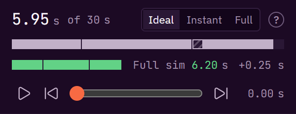

The timeline sits above the steps. It shows each step's time as a bar against the 30 second autonomous period, and a scrubber you can drag to move the robot through the routine.

The timeline's head shows one total, the playback level's, against the period, such as `15.85 s of 30 s`. A quiet `~` before an Ideal total means it is rough: a step with no predictable time counts as zero, or a path that ends on a condition is timed as if it drove all the way; hover it for which. A sim total has no `~`, and until the chosen level has a total of its own the head shows the estimate's, as **Estimate total**. Hover the total for what it measures, and for the estimate alone when that differs. The scrubber row starts with **Play**, which plays and pauses as `Space` does.

The level switch at the right of the head picks what the robot on the field, the scrubber, the total and the bars run on. There are three levels, and **Ideal** is the default:

| Level | What plays |
|---|---|
| Ideal | The planned path exactly, with no wobble or overshoot, timed by the estimate. Where a step does not start where the last one ended, the robot turns or drives across the gap. |
| Instant sim | Zenith's own follower and drivetrain model, run after every edit: a rough idea of how the robot really drives the path. |
| Full sim | The robot repository's own simulation, from a trace it wrote. Disabled until a trace is loaded. |

Hover a level for what it means, or a disabled one for why it is disabled. The switch reads Ideal, Instant and Full, and it is the one place on the timeline that names the level; the robot's label on the field names it too. [Simulation](simulation.md#playback-levels) says more about each level.

- **Solid bars** are estimates. At the Ideal level they are the estimate's own bars, with a **hatched block** wherever the robot drives across a gap before a step. A path that starts facing another way from how the robot arrives, such as a tangent path leaving a corner, turns in place first: its bar opens with a **hatched lead-in** as long as that turn, which counts in the total and the time budget. At the Instant sim level the sim's time is the main bar, with the kinematic estimate as a band beneath it.
- **Striped bars** have no estimate, usually because a command's duration is not declared in the robot file.
- **Green bars** are a recorded run from a simulation, laid over the plan.

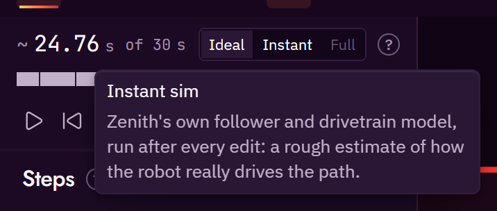

Press `Space` (or Play) to play and pause. `,` and `.` step the playhead back and forward 0.1 s, or by the step you set in Settings, Editor, Editing. The Steps panel highlights the steps running at the playhead.

### The instant sim

Zenith has a built-in simulator that follows each path the way the robot's path follower does, within the robot's speed, acceleration and turning limits from `robot.json`. It runs again after every edit, fast enough to keep up with a drag. Choose **Instant sim** under the scrubber to play its result; the timeline then shows its preview bars. It needs no setup.

The **Simulate** button and the desktop app's **Run high-fidelity sim** run the robot repository's own simulator instead, which is slower and closer to the real robot. See [Simulation](simulation.md).

## The field

The field is the large region in the middle. It shows the field from above, with the routine drawn on it.

- Paths are thin light lines. The selected step's path is brighter and thicker.
- When a step is selected, or the pointer is over it, its **handles** appear: filled squares for end points and hollow squares for curve control points. You can drag any path's handle straight away, without selecting the step first; the drag selects the point, so the arrow keys and `R` then act on the point you dragged, and one undo puts it back.
- To **make a curve**, right-click a straight path and choose **Make curve**, set the path's **Kind** to **Curve** in the inspector, or select the path and run **Make curve** from the command palette. The new curve starts on the line, with one hollow square in its middle, so nothing about the route changes yet; drag the hollow square to bend it. **Make straight line** turns a curve back into the line between its two ends.
- Drag the routine's **start** to move it, keeping its heading, or drag its heading arrow to turn it. Click it to select it, and the arrow and `R` keys nudge and turn it. A path whose first point sits on the start, as in the starter autos, moves with it.
- A start or a path point that **follows a waypoint** gets a pose of its own where you drop it when you drag or nudge it, when you turn the start, or when you take **Move start**, the fix that moves the start to the nearest legal spot. Turning a path point turns its step's heading mode instead, so the point keeps following its waypoint. The status line says it no longer follows the waypoint, and one undo makes it follow the waypoint again. The waypoint itself does not move.
- **Waypoints** are the small pins with a stem, named from `waypoints.json` once you zoom in. A pin's name is drawn in the waypoint colour, bold and italic with a halo, so it is not mistaken for a step's name, and a name that would overlap another pin's name is left out: the selected pin always keeps its name, and otherwise the first by name does. The flag icon in the palette and the inspector marks a waypoint; the map pin is the Marker tool's. The field draws only the waypoints the open auto follows; select another in the inspector's **Waypoints** list to show its pin until you select something else. See [Waypoints explained](#waypoints-explained). Drag a pin with the select tool to move the waypoint: it snaps as a point does, keeps its heading, and every point that follows it moves with it at once, in this auto and in every other auto that follows it. Click a pin to select it; the arrow keys then nudge it and `R` turns it. A pin labelled Measured or Calibrated from robot only selects on its first press, and the next press-drag moves it (see [Protect measured waypoints](#protect-measured-waypoints)). A moved waypoint's provenance becomes "Set from editor", and one undo puts a whole drag back. A dot or the start mark drawn on a pin keeps the press, as in the starter autos, where the start and driveOut's first point sit on the pin `start`: grab the pin by its name, or select it in the inspector's **Waypoints** list (or with **Select waypoint** beside the start or a path end), and the selected pin then takes the press wherever it is drawn. See [Editing waypoints](#editing-waypoints).
- The selected step also shows its **heading arrows**, in light blue, which belong to its heading mode rather than to a point:
  - **Constant**: an arrow at each end. They are one angle, so turning either turns both.
  - **Linear**: a start arrow and an end arrow, each turned on its own.
  - **Tangent** and **Reverse tangent**: dashed arrows that show the way the robot faces. The path decides them, so they cannot be dragged; hover one to see why.
  - **Facing point**: the point itself, a ring with a cross, which you drag like a point.
  - **A turn on the spot**: only the end arrow, because the robot turns from whichever way it arrives facing.
  - **Piecewise**: the same arrows for each range, and a tick across the path at each boundary between ranges. Drag a tick along the path to move the boundary. Right-click a path and choose **Split heading here** to cut the heading into two ranges. A Linear heading that sweeps more than half a turn over several segments turns each segment's share the short way, so it becomes one range per segment first, and the robot still turns the way it did.
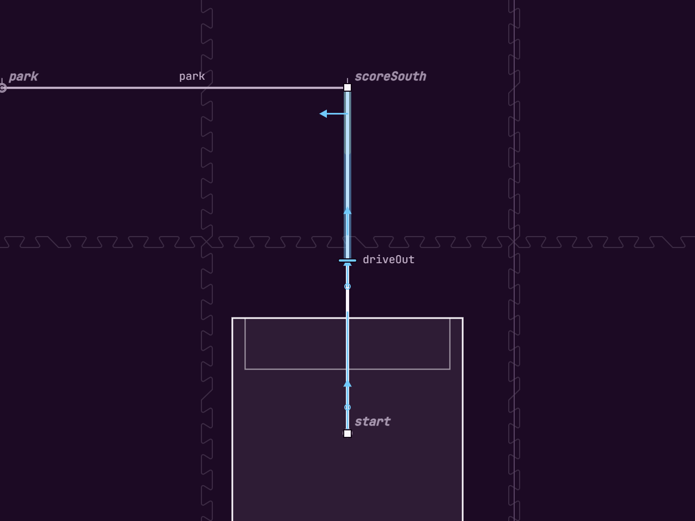

- Heading arrows snap to 15° steps. Hold `Shift` for 45° steps, `Alt` to turn freely, and `Ctrl` to flip the snap toggle.
- A step's **envelope**, the rectangle its robot stays inside while the step runs, is a hatched outline. To make one (the **Stay inside** row comes with the **Commands** switch, which is on unless you turned it off), select the step, open **Advanced** at the end of the inspector and press **Draw box** on that row, then drag on the field from one corner to the opposite (`Shift` draws a square, `Esc` cancels), or press **Add 24 in** for a square round where the step starts. While the step is selected, its envelope shows a diamond at each corner and a bar at the middle of each side. Drag a corner to resize the two sides it joins while the opposite corner stays put (`Shift` keeps its shape), drag a side or its bar to move that side alone, and drag inside the envelope to move all of it (`Shift` keeps it to one axis). Everything snaps like a point, and an envelope never turns inside out: dragged past the opposite side, it flips over. One undo puts a whole drag back. The inspector shows the envelope as x and y (its smallest corner), width and height, all in inches, and you can type them. An envelope written as some other shape, by hand or by an agent, is drawn as it is without handles; the inspector offers to make it the rectangle round it.
- While a command that drives the robot by itself (`movesRobot`) runs, nobody knows where the robot is, so the playback robot is a ghost: drawn in iris, a blue-violet, the way a partner's robot is, and labelled with the level and "position unknown", such as "Ideal · position unknown". Its step's envelope is hatched in the same colour while its time is running, and in the annotation colour otherwise. When the path after the command has a rejoin pose, the ghost drifts from where the command starts to that pose within the command's time, at the Ideal and the Instant sim levels alike, so the path starts where the ghost stops. No line is drawn for the drift.
- **Markers** are small pins on a path. Their names appear on hover. Click one to edit it in the inspector, or drag it along its path.
- One **robot outline** shows where the robot is at the scrubber's time, or where the cursor is hovering on a path. It is drawn at the robot's real footprint, intakes included.
- The cursor's position and a scale bar sit in the bottom corners of the field.
- Field element labels (such as the names of the hives and flowers) are hidden until you hover them, or turn labels on.

### The drawn field

Zenith draws the whole field from the season's geometry, the same shapes the checks test against:
the tiles with their 24 inch seams (and finer lines between them if you choose them under
[the field's grid](#the-fields-grid)), the walls, each alliance's
loading zone and garden in its own colour, the alliance areas outside the walls, the flowers, the
hives with their up cell filled and its nectar, and the staged pollen. Nothing is a picture, so
what you see is what the checks use.

The hive frame's four slanted legs are drawn over the hives. The part of each leg below the top of
your robot is filled like any obstacle you cannot drive through: it is exactly what
[`STRUCTURE`](checks-and-findings.md#structure) tests against, so it grows toward the hive's middle
when you make the robot taller in Settings, Robot. Structure the robot passes under at its height
(each whole leg, the crossbar and a hive it fits beneath) is a dashed outline. **Overhead outlines**
in Settings, Editor, Field, or in the palette, hides those dashed outlines for you alone; the filled
part of a leg always shows. Pointing at a `STRUCTURE` problem on a leg outlines that filled part.

The [`CLEARANCE`](checks-and-findings.md#clearance) warning marks where the robot passes a
structure closer than its clearance from field elements without touching it. The clearance belongs
to the robot: Settings, Robot shows "1 in (default, not in robot.json)" until you press **Set**,
which writes `footprint.clearanceIn` to `robot.json`, labelled SET BY HAND, for you to change and
save. **Clearance outline** in Settings, Editor, Field draws the robot at the playhead with a faint
dashed outline that much bigger, for you alone; it is off unless you turn it on or choose the Full
preset, and it never changes the warnings.

### The field's grid

**Grid**, in Settings, Editor, Field, chooses how much of the field's grid is drawn under your routine. It is yours alone, and `Field grid` in the palette steps through the same four choices:

| Grid | What you see |
|---|---|
| Off | The floor alone, with no lines. |
| Tiles (24 in), the default | The floor and the seams between the 24 in tiles, each drawn with the tiles' interlocking tabs, as FIRST's field CAD has them. |
| 12 in | The tile seams, and a line every 12 in between them. |
| 6 in | The tile seams, and a line every 6 in. |

The seams on the wall are straight, as the tiles are cut there, and the centre lines run straight through the middle seams. Zoomed so far out that a tab would be under 2 pixels deep, every seam is drawn as a straight line. Lines closer than 2.5 pixels together are left out when you zoom far out, so the field never turns to noise. A field picture draws as it is, with no grid over it, whatever you choose. **Snap** stays on its own: it does not follow the grid you draw.

### Field views and styles

A field file of your own may name a picture of the field (see
[field image](file-format.md#field-image)). With one, **Field view** cycles between three ways of
drawing it, and is disabled without one:

| View | What you see |
|---|---|
| Image and outlines (the default) | The field picture, with the outlines of the walls, elements and zones the checks use drawn over it. |
| Image | The field picture alone. |
| Vector | The drawn field alone. |

**Field style** switches the field picture between the looks the field file provides, such as dark, black and light. It is disabled when the field has only one picture, or none.

### Canvas gestures and modifiers

These are the gestures the field understands. The table is taken from the editor's own gesture list (`CANVAS_HELP` in `apps/web/src/canvas/help.ts`), which the tour and the shortcut sheet also read.

| Gesture | What it does |
|---|---|
| Click | Select a point, a marker or a path. |
| `Shift` + click | Add a point to the selection, or take it out. |
| `Alt` + click | Where paths overlap, select the next one under the pointer; a plain click keeps the selected one. See [Overlapping paths](#overlapping-paths). |
| Drag on empty field | Draw a box and select every point inside it. Hold `Shift` to add to the selection. |
| Drag a point or a waypoint pin | Move it, even on a step that is not selected, and select it; a selected point carries the others, a pin the points that follow it. A dot or the start mark on a pin keeps the press, and a measured pin's first press only selects it; see [Editing waypoints](#editing-waypoints). |
| Drag the start mark | Move the start, keeping its heading, with any path that starts on it. Drag its arrow to turn it; click it to nudge it. A start that follows a waypoint stops following it. |
| `Esc` | Cancel a drag, or clear the selection, the measurement or an open menu. |
| Hold `Ctrl` while dragging | Flip the snap toggle for this drag: snap when it is off, move freely when it is on. |
| Hold `Alt` while dragging | Turn off the grid and the 15° heading steps only; waypoints and walls still snap. |
| Hold `Shift` while dragging a path end or node | Keep it on a line from the other end of its path, at the line's own angle or the nearest 45°, and as short as you like. The rest of the selection moves with it. |
| Hold `Shift` while dragging the start or a pin | Move along one field axis only. |
| Hold `Shift` while turning a heading | Turn in 45° steps. |
| Hold `Shift` while dragging a curve handle | Move this handle alone, without swinging the one opposite it. |
| Drag a point near a wall | The robot rests flush against the wall, intakes included, so it never leaves the field. |
| Drag a path end onto a waypoint's pin | The end follows the waypoint, so moving the waypoint later moves it too; a curve handle only takes its spot. See [Snapping](#snapping). |
| Drag a heading arrow | Turn the heading: a Constant's two arrows turn together, a Linear's ends apart. |
| Drag a tick across the path | Move the boundary between two heading ranges along the path. |
| Drag an envelope corner or side | Resize the selected step's envelope; the opposite side stays put. It snaps like a point; `Shift` keeps a corner's shape. |
| Drag inside an envelope | Move the selected step's envelope without changing its size; `Shift` keeps it to one axis. |
| **Draw box** in Advanced, then drag | Draw a step's new envelope from one corner to the opposite; `Shift` draws a square. |
| Right-click a path, Split heading here | Cut the heading into two ranges there, each with its own mode. |
| Right-click a path, Make curve | Turn the path there into a curve, as Kind Curve in the inspector does, then drag the hollow square in its middle to bend it. |
| `S` | Make the selected curve point smooth: its two handles stay in a line. |
| `C` | Make the selected curve point a corner: its handles move on their own. |
| Right-click | Open the menu for a point, a path, a waypoint pin or the field. |
| Double-click a pin | Rename the waypoint, as `F2` does with the pin selected; the pin does not move. |
| Double-click a path | Add a point there, splitting the path in two; dragging or nudging the point moves both halves' ends together. `Del` on that point joins them again. |
| `Del` on a selected point | Delete just that point and keep the path chain joined; see [Selection and marquee](#selection-and-marquee). |
| Click the field (Add path tool) | Add a path point where the dashed line and the readout show it, snapped, continuing from the last one or from the step you are inserting after, or, with **Extend this chain** on and a path step selected, as a new path of that step's chain; on a waypoint's pin the new end follows the waypoint. |
| Hover a path | Show the robot there, with how far along the step it is and when it gets there. |
| `U`, then drag | Measure the distance and angle between two points. `Shift` keeps the angle to 45° steps. |
| Middle-drag, `Ctrl` + right-drag, or `Space` + drag | Pan the field, as in Onshape. |
| Scroll | Zoom about the pointer. |
| `F` | Zoom to the selection, or to the whole routine when nothing is selected. |
| Double-click empty field | Fit the field board and the routine in view. |

The field's bottom-right corner holds **Zoom to fit**, **+** and **−**, and the zoom as a percent of the fit. **+** and **−** zoom about the middle of the field view, and **Zoom to fit** frames it again. The field has no Play button of its own; the toolbar's Play and `Space` play and pause.

**Zoom to fit** (the corner's button, or a double-click on empty field) frames the field board itself, as large as the view allows, so at 1280 x 720 the board fills most of the view's height; the alliance zones outside it may be cut off at the edges. Any part of the routine drawn outside the board, such as a curve handle dragged past a wall, is framed too, with room for the robot's outline round it, so it is still in view. Zenith works out that area when you fit and when an auto opens, and keeps it: until you pan or zoom, resizing the window or a panel fits that same area again, so an edit never moves the view by itself. While you pan or zoom, the whole field stays drawn, including the parts that were off screen when you started. A field picture that takes too long to draw is the one exception: while it moves, the part that was off screen fills in once the view stops.

While you drag, a small readout next to the cursor shows x and y in inches, the heading in degrees, and which snap is acting. On a path point, while you drag it or hover it, the heading is the one the robot has there, from the step's heading mode. Snap and measure guides disappear when you let go. Nothing on the field moves by itself except playback.

Press `Esc` during a drag to cancel it: whatever the drag moved, turned or drew goes back to where it was at the press, with nothing added to the undo history, and the selection stays as it is. The status line says "Drag cancelled.", and drawing an envelope stops. A drag the browser cancels, or one whose pointer the field loses, is cancelled the same way, and its release is not a click. A press belongs to the mouse button or finger that started it: a second finger on the field while one is down does nothing until the first one lifts.

#### Overlapping paths

Where the paths of several steps run over each other, the selected step stays on top. A click, a hover, a double-click and a right-click there go to the selected step's markers first, then to its path, then to other steps' markers (a later step's before an earlier one's), and last to other steps' paths (the nearest, and the later step's where two are as near). So a double-click on an overlap splits the selected step, not the one drawn over it.

To reach a step underneath, hold `Alt` and click with the select tool: the next step under the pointer is selected, and further `Alt` + clicks at the same spot visit each step there in turn and come back to the first. A plain click never moves on, so the two clicks of a double-click keep the step it splits, and two quick `Alt` + clicks split nothing. A point, the start mark and a waypoint pin sit on top of the paths, so an `Alt` + click on one of them does what a click does: it selects the point, the start or the pin, never a step underneath.

### Snapping

With **Snap** on (`S` in the toolbar), a dragged point stops at named waypoints, at walls and at the grid, and a heading stops at 15° steps. The modifiers above change this for one drag: `Ctrl` flips snapping, `Alt` keeps waypoint and wall snapping but drops the grid and the 15° steps, and `Shift` keeps a path end on a line from the other end of its path, and the start or a pin to one axis. On that line the length rounds to half an inch, a waypoint catches the end only if it lies on the line, and a wall moves the end along it. Clicking with the Add path tool while holding `Shift` does the same from the end the new path continues from, so the new line runs at a multiple of 45°.

**Waypoint snap** puts a point on a waypoint when the pointer comes within 6 px of its pin. Only a pin drawn on the field catches a point: one the open auto follows, or the one selected in the inspector's **Waypoints** list. A path's end that snaps onto a waypoint, by a drag or by an Add path click, follows it: the file says `{ "ref": "scoreSouth" }` instead of copying the waypoint's numbers, so moving the waypoint later moves the end too, and the status line says so, for example "Point 1 of path1 now follows waypoint scoreSouth." Where one path of a chain ends and the next starts, both ends follow it. An end that already follows the waypoint keeps following it, even when one drag takes it off the pin and back again. A curve handle cannot follow a waypoint, so a handle snapped onto a pin takes the waypoint's numbers with the waypoint's own provenance, not "Set from editor". `Alt` still snaps onto waypoints; to keep a point's own numbers next to a pin, hold `Ctrl` or turn Snap off. One undo takes a whole drag back, link and all.

**Wall snap** uses the robot's full footprint: the body and every intake mouth. A pose snapped to a wall sits flush against it without crossing it, so it never produces a "leaves the field" problem.

**Before you click.** With the Add path tool, the dashed line runs from where the new step starts to where a click would put the point, already snapped, and the readout at the bottom left of the field shows that point and names the snap: `wall`, `waypoint park` or `grid 0.5 in`. A ring marks a waypoint it snaps onto, and a line the wall. The Add command tool's readout does the same. The click puts the point exactly there, and **Add a path here** on the field's right-click menu puts it where an Add path click at that spot would. A new path's point faces the way the path drives, and the wall snap rests the robot against the wall at that heading. No robot outline is drawn for it. The preview is always where a click at the pointer would put the point, even while the pointer holds still: it shows as soon as you pick Add path with `P`, and it follows a zoom, the snap toggle, held keys and a change of selection: with nothing selected, the new path continues from the routine's last step. It goes when the pointer leaves the field and when you pick a tool that adds nothing. Within 0.75 in of the point the new path starts from, where a click places nothing, there is no dashed line and the readout shows no point.

### The heading of a new path

**Heading for new paths**, in Settings, Editor, chooses the heading mode a path starts with when you add it with the Add path tool, **Add a path here**, Insert or the palette, and the first path of a new auto (**New auto**). It is yours alone, kept in this browser or the desktop app, and never written into an auto.

**Start a new path with the previous path's end heading**, next to it and on unless you turn it off, makes a new path start at the heading the robot has where the step before it ends. A Linear path then ends at that same heading until you change it, so a click does not turn the robot toward the way it drives, Constant holds it, and Tangent is unaffected. The Add path preview shows that heading at the point (not with Tangent as the heading for new paths). A clear path that ends at a legal approach to a season target is the one exception: it still turns to face the target. With **Extend this chain** on, the paths it adds keep the heading the chain ended at: a Linear heading turns as far as the old end and then holds, as two ranges, rather than stretching one turn over the longer chain. Off, a Linear new path turns to the heading the preview shows, the way it drives.

| Choice | What the new path does |
|---|---|
| Tangent | Faces the way it drives, as every new path did before this setting. |
| Linear, the default | Turns from the heading the robot arrives with, at the end of the step before, to the heading at the path's end. A path from the Add path tool ends at the heading the preview showed, facing the way it drives there; a path from Insert or the palette ends at the heading it began with, so it does not turn until you edit it. |
| Constant | Holds the heading the robot arrives with. |

The setting only chooses where a path starts. Change a path's **Mode** in the inspector at any time, and a path already in a file keeps the mode it has. A path inserted facing a nearby wall, which has no room to go ahead, always holds the heading it arrives with, whatever the setting says, so it cannot swing a corner off the field. It holds it as Linear from that heading to itself, the same as any new path with the default settings, and as Constant only if **Heading for new paths** is Constant. A turn on the spot is always Linear, and a new auto's template still starts with Tangent.

### Nudge, rotate and playhead steps

Four numbers in Settings, Editor, **Editing** set how far a key moves. They are yours alone, kept in
this browser or the desktop app, and never written into an auto. Each shows its unit, and a number
typed past its range stops at the end of it, and is kept to the two decimals the field shows.

| Setting | What it sets | Default | Range |
|---|---|---|---|
| Nudge | An arrow key's step for the selected point, start or waypoint pin | 0.5 in | 0.05 to 12 in |
| Far nudge | `Shift` and an arrow key | 2 in | 0.1 to 24 in |
| Rotate | `R` and `Shift R`, for a point, the start or a pin | 5° | 0.5 to 90° |
| Playhead step | `,` and `.`, and the timeline's two step buttons | 0.1 s | 0.01 to 1 s |

The shortcut sheet, the timeline's button names and the hints that mention these distances say the
numbers you set. A stored number that is out of its range, or is not a number, is read as the default.
Presets do not change them.

### Protect measured waypoints

A waypoint labelled **Measured** or **Calibrated from robot** is a pose someone took on the field, and one
stray drag could replace it. **Protect measured waypoints**, the first row of Settings, Editor, **Editing**,
is on in every preset. With it on, the first press on such a pin only selects it, and the status line says
so; the next press-drag moves it. The arrow keys and `R` act on a selected pin, as for any pin, and a pin
with any other label drags at once. Typing a number in the **Waypoints** list stays allowed, because typing
is deliberate: with the pin's row open the list says "This changes MEASURED to SET FROM EDITOR if you change
a number here" before anything is committed, and the chip sets the label back in one step. Turn the setting
off and every pin drags on its first press, as it did before. It is yours alone, kept in this browser or the
desktop app, never written into `waypoints.json`, and there is nothing to unlock.

### Smooth and corner points

A point where two curved paths meet is either **smooth** or **corner**. A smooth point keeps its two handles in a straight line, so dragging one swings the other and the path flows through without a kink. A corner point lets each handle move on its own, so the path can change direction sharply. Press `S` or `C` with the point selected, or use the right-click menu. Holding `Shift` while dragging a handle breaks the mirroring for that one drag.

### Selection and marquee

Click to select one point, `Shift` + click to add or remove points, or drag on empty field to draw a box round several. Dragging any selected point moves all of them together, whether `Shift` went down before or after the press. Dragging a point that is not selected selects that point alone. The arrow keys nudge the selection by 0.5 in, and `Shift` + arrows by 2 in. `R` and `Shift R` turn the heading at the selected point by 5° one way or the other (the distances are settings: see [Nudge, rotate and playhead steps](#nudge-rotate-and-playhead-steps)). On a path point they turn what the heading arrow at that end of the path turns, because the step's heading mode alone decides which way the robot faces: Constant's angle, or Linear's From at the path's first point and its To at the last, and in a piecewise heading the first or last range's. The point itself is not changed, so a point that follows a waypoint keeps following it. Under Tangent, Reverse tangent or Facing point the path decides the heading, so `R` changes nothing there and the status line says what decides it, for example "driveOut's heading comes from Tangent; switch to Linear or Constant to turn it here."

Where one path of a chain ends and the next starts, such as the point a double-click adds, the file holds two ends, but the editor treats them as one point: dragging it, snapping it, nudging it or typing its numbers moves both ends in the same edit and the same undo step, so the path never tears there. Two ends within 0.5 in of each other, or that follow the same waypoint, count as one point, and a selection that holds both moves it once. No heading mode holds an angle of its own at such a point, so its heading row in the inspector says the mode decides it there, and `R` changes nothing and says so on the status line.

`Del` on one selected path point, or **Delete point** in its right-click menu, removes just that point and keeps the chain joined. A point where two paths meet joins them into one path: two straight lines make one line, and otherwise a curve that keeps the outer control points. The end of a chain of several paths removes its last path. A curve's control point goes on its own, and removing the last one makes the path a straight line. The chain's first point, or the end of a chain of one path, cannot go without the step, so there `Del` deletes the step and Delete point says why it cannot. The status line says what went, which waypoint the chain no longer follows, and which markers or heading ranges moved, and one `Ctrl Z` puts it all back.

### The context menu

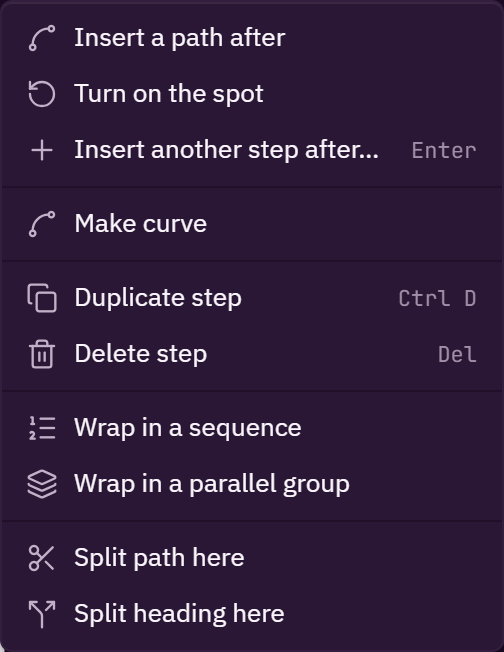

Right-click shows the actions that apply to what is under the pointer, and only those: an item that could never work there is left out rather than greyed, and the tools and zooms, which have their keys, the toolbar and the field's corner controls, are not repeated. The menu opens at the pointer, or just above it near the bottom of the window. Each item shows its shortcut, and `Del` shows only on the item `Del` itself runs. A greyed item says why in its row.

| Right-click on | Menu items |
|---|---|
| A point | Insert a path after, turn on the spot, insert another step after, duplicate step, delete point, delete step, then, for a point that follows a waypoint, **Waypoint scoreNorth** with select, rename, hide and select the points that follow it (or save as waypoint for a point of its own), wrap in a sequence, wrap in a parallel group, and unwrap group inside a group |
| A curve's control point | Make smooth or make corner, whichever changes it, and delete point |
| A path | Insert a path after, turn on the spot, insert another step after, make curve on a straight line or make straight line on a curve (for the path under the pointer), duplicate step, delete step, wrap in a sequence, wrap in a parallel group, and unwrap group inside a group |
| A step in the Steps panel | Play from here, insert a path after, insert another step after, duplicate step, delete step, wrap in a sequence, wrap in a parallel group, wrap in a branch, unwrap group |
| A marker | Change command (selects the marker and puts focus on its command), delete marker |
| A waypoint pin | Rename, delete, hide or show, copy position, select the points that follow it |
| Empty field | Add a path here, add a waypoint here, the clear path, then **Show waypoint pins** with All, This auto's and None (a check on the one shown), and field view and field style on a field with a picture |

After these, the field adds its own items where they apply: make smooth or make corner on a curve point, and split path here and split heading here on a path.

### The measure tool

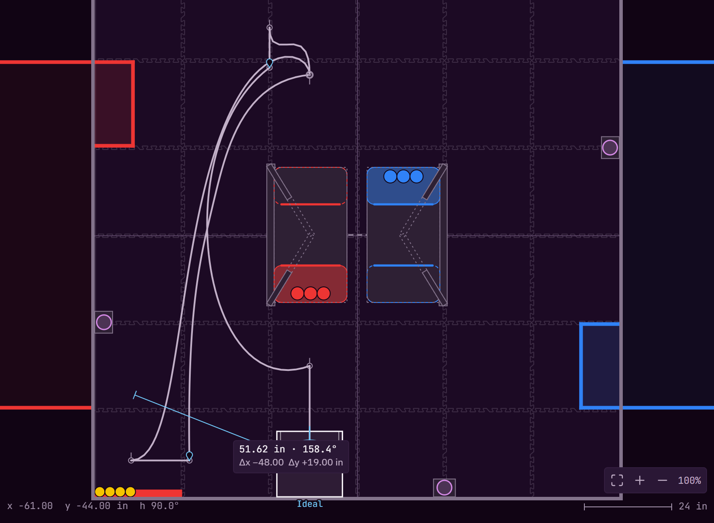

Press `U` (or click Measure), then drag between two points on the field. The readout shows the distance in inches and the angle in degrees. Hold `Shift` to keep the angle to 45° steps. `Esc` clears the measurement. `M` is not used for measure because it picks the Marker tool.

### Waypoints explained

A waypoint is a named spot on the field, such as `scoreSouth` or `park`. You measure it once on the real field and save it in the project's `waypoints.json`. Any number of autos can follow it: a start or a path end that follows a waypoint says `{ "ref": "scoreSouth" }` in its file instead of copying the numbers. Move the waypoint once and every auto that follows it moves with it. A waypoint belongs to the project, not to a path, so it stays when the paths that used it are deleted.

This is the main difference from planners where every point belongs to one path. There, the same scoring spot is typed again in each path of each auto, and when the team measures it again on the real field, every copy has to be found and changed. In Zenith you change the waypoint.

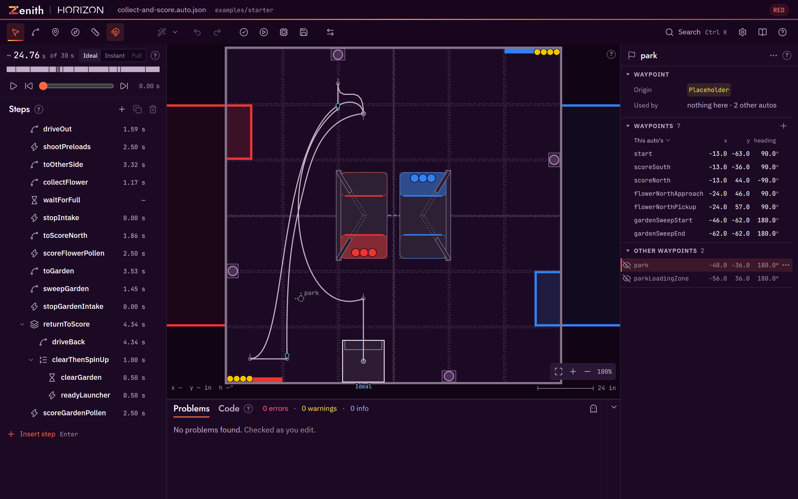

- **The field shows this auto's waypoints.** A waypoint the open auto does not follow is not drawn, whether other autos use it or none do, so the field shows where this auto goes. That is **Waypoint pins** set to **This auto's**, the default; choose **All** in the **Waypoints** list's **Pins** row to see every pin, or use a row's eye to show or hide one pin. See **Hide** under [Editing waypoints](#editing-waypoints).
- **The rest are in the inspector.** The **Waypoints** list starts with the ones this auto follows. The others are under **Other waypoints**, with how many there are beside the title, closed until you open it, and one that no auto in the project follows says "Not used by any auto". Select one there to show its pin on the field, faint and dashed: you can drag it, nudge it, or snap a point onto it so the point follows it. It hides again when you select something else.
- **Following one.** The **Waypoint** picker beside the start, or a path's From or To, lists every waypoint, shown on the field or not. Pick one and the point follows it, and its pin shows from then on.
- **Nothing is deleted for you.** A waypoint no auto uses stays in `waypoints.json` until you select it and press **Delete…**.

### Editing waypoints

A waypoint is a named pose in the project's `waypoints.json` that autos follow, so it is measured once and used everywhere. The editor moves, adds, renames and deletes them:

- **Move.** Drag its pin, or select it and use the arrow keys and `R`, or type its numbers in its row of the inspector's **Waypoints** list. Every point that follows it moves with it at once. Dragging and the keys set its provenance to "Set from editor"; typing keeps the label it had, except that a number typed over **Measured** or **Calibrated from robot** warns "This changes MEASURED to SET FROM EDITOR" on the status line and relabels it (with **Protect measured waypoints** on, the row says the same before you type, and such a pin's first press on the field only selects it), and the row opens to its chip, so one click on the chip and **Measured** sets the label back. When a drag ends, or on the first key of a run of arrow or `R` keys, the status line names the label it replaced when that was not "Set from editor", names the other autos that follow the waypoint, and offers `Ctrl+Z`.
- **Other autos.** The selected row's **Used by** line counts the points of this auto and the project's other autos that follow the waypoint, for example `Used by point 1 of driveOut · 3 other autos`; rest the pointer on it for the full lists. Once an edit has rested for a moment, Zenith checks each other auto with the saved waypoints and with the new ones, and the line adds how many errors the change gives them, for example `2 other autos, 1 new error`, with each auto's count in the hint, such as `cycle-and-park (1 new error)`. Only errors the change adds are counted. Each other auto is read once per project.
- **Add.** **Save as waypoint…** beside the start, or beside a path's From or To, makes a new waypoint at the pose that point stands at, with its provenance, and the point follows it from then on. On a From or To the waypoint takes the heading the plan gives the robot there; when that is not the heading the point holds, or the point holds none, Zenith worked the heading out, so the waypoint is labelled "Set from editor" instead. The name starts with a letter and holds only letters, digits, `_` and `-`. The suggested name is `start` for the start and the step's id and `End` for a path's end, for example `driveOutEnd`.
- **Add here.** Right-click empty field and choose **Add a waypoint here** to make a waypoint with no path step. It opens **Add waypoint** with `waypoint1` selected, so Enter takes the name and typing replaces it. The pin goes where an Add path click there would put its point, snapped the same way and facing the way that click would face, labelled "Set from editor", and it is selected. The auto does not change, only waypoints.json, and one undo takes the pin away. Where the spot snaps onto a pin that is there already, the item is greyed and says which. The palette's **Add waypoint**, and the **+** in the **Waypoints** list's header, wait for a click on the field, then ask the same question; the line at the top of the field says "Add waypoint: click the field to place it. Esc to cancel" for as long as it waits, and `Esc` cancels without changing anything.
- **Right-click.** A pin has its own menu, and the right-click selects it first: **Rename…** (`F2`), **Delete…** (`Del`), **Hide** or **Show** (see **Hide** below), **Copy position**, **Select the points that follow it** and **Zoom to it** (`F`). The **⋯** at the end of a pin's row in the **Waypoints** list selects it and opens this same menu. **Copy position** puts the pose on the clipboard as the files write it, for example `{"xIn":-40,"yIn":-36,"headingRad":3.1416}`. A pin under a dot or the start mark cannot be right-clicked itself, so right-click the dot or the start mark: when it follows a waypoint the menu offers **Select waypoint X** and **Rename waypoint X…**, and when it has a pose of its own it offers **Save as waypoint…**. Hovering a dot that follows a waypoint says "follows waypoint X". The palette lists **Rename waypoint…** and **Delete waypoint…** while a pin is selected.
- **Rename and delete.** **Rename…** and **Delete…**, in the pin's right-click menu and in the **⋯** menu on its row in the **Waypoints** list, first say which autos in the project follow it, this one and the others. A rename points this auto at the new name; a delete gives this auto's points a pose of their own at the waypoint's spot, with its numbers and provenance, and the status line says what no longer follows it. Other autos are not changed: the dialog names them, and each shows an error until it is opened and changed. With a pin selected, `Del` or `Backspace` opens the same delete dialog with focus on **Delete**, so `Del` then `Enter` deletes it and nothing goes without the dialog. `Ctrl+Z` brings the waypoint back, selects its pin again and says "Waypoint X is back."
- **Hide.** **Waypoint pins** in Settings, Editor, Field, and on the empty field's right-click menu and in the palette, chooses which pins the field shows: **All**, **This auto's** (only the pins the open auto follows, the default, and the Basic and Essential presets' choice) or **None**; the Full preset chooses **All**. The **Waypoints** list has the same choice as its **Pins** row. **Hide** on a pin's right-click menu, the eye at the start of its row in the **Waypoints** list, or **Hide waypoint** in the palette with the pin selected, hides that one pin whatever the mode says, and **Show** or the eye again brings it back; the choice is kept per project, only where it differs from the mode. A hidden pin's row is dimmed, and the **Pins** row's tooltip says how many pins are hidden; the section's title only counts the waypoints, as in `Waypoints (11)`. **Show all**, above the rows while you have hidden or shown pins one by one in this project, forgets those choices for this project only, so every pin follows the mode again. A hidden pin is not drawn, cannot be hovered, clicked or right-clicked, is no snap target for a drag or an Add path click, and is left out of **Download picture**. The selected pin is still drawn, faint and dashed, so a hidden pin can be selected from the inspector's **Waypoints** list, dragged, snapped onto, and right-clicked for **Show**. Hiding a selected pin clears the selection. Points that follow a hidden waypoint are still drawn, and hovering one says "follows waypoint X (hidden)". Hiding is yours alone: it never changes `waypoints.json`, adds no undo step and leaves nothing unsaved. A rename keeps a hidden pin hidden under its new name, and a delete then undo keeps it hidden.

Each of these is one undo step, and the toolbar marks the auto as unsaved until you save. When only `waypoints.json` has changes, the question before opening another auto says so, for example "waypoints.json has changes that are not saved (2 other autos follow gardenSweepStart). Discard puts them back.", rather than blaming the auto; with both changed it names both files. **Save** says "Saved first-auto.auto.json and waypoints.json." and, when the change gave another auto errors, adds "cycle-and-park now has 4 errors." on every save path. It writes `waypoints.json` in canonical form, before the auto, wherever the project can write it: a folder, the desktop app, and GitHub mode, where it is committed to the open auto's work branch with the auto (and **Propose** carries a change not yet saved). On the read-only example, or files opened on their own, the changed waypoints go with **Save the full project**; **Just this auto** waits until they are saved or undone. Where the project cannot write `waypoints.json`, waypoint editing is off, the rows' numbers are read only, and the Waypoints list says why in one sentence: in a window another app opened (host mode, which sends back autos only), when `zenith.json` names no waypoints file, in a desktop app too old to write it, and on GitHub when the file is outside the folders Zenith may commit to.

## Inspector

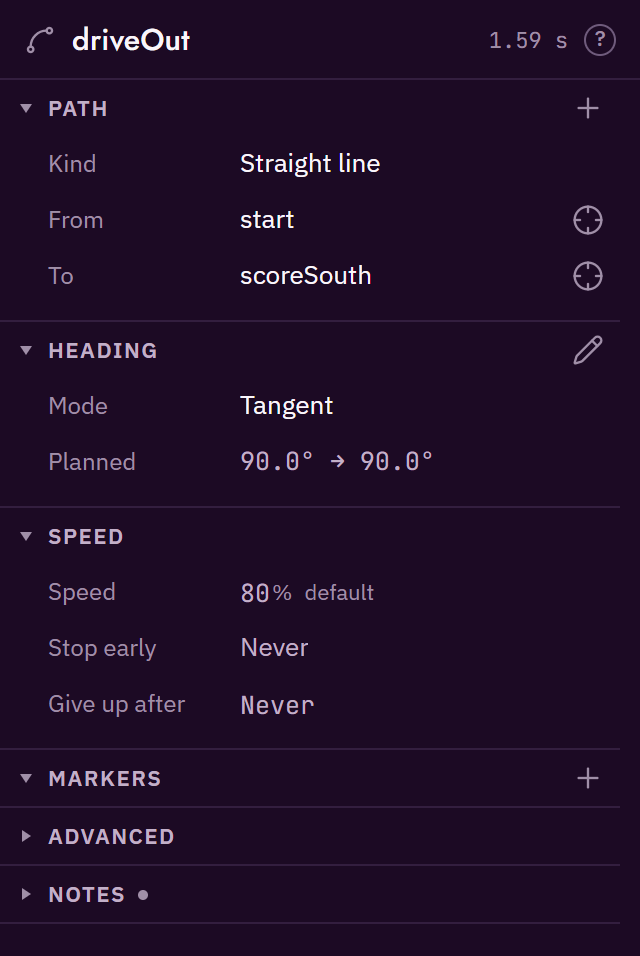

The inspector shows the selected step's settings. Its header names the step's kind and id, shows its
estimated duration and offers help. Sections such as **PATH**, **HEADING** and **SPEED** group the
settings; list titles include their item count. Default values are muted so changed values stand out.

### Edit numbers

Click a value to select its text and type a replacement. You can also use `↑` and `↓`, or drag
sideways on a number while you are not typing. Four pixels make one arrow step; angles change by
1° per pixel. `Shift` makes the change faster and `Alt` finer. Press `Esc` during a drag to restore
the starting value. One undo reverses the whole drag.

Typed values outside a field's range, and text that is not a number, are refused: the previous value
returns and the status line states the allowed range. The tooltip also gives that range. Arrow keys
and dragging stop at the bounds. Counts remain whole, and the displayed value reflects what the
file keeps after an accepted edit. While typing, dragging selects text instead of changing the value.

### Read and change provenance

A pose row shows x, y and the unit, with a provenance chip below: for example, **Measured**,
**Placeholder** or **From editor**. Hover the chip for the full label and its meaning. Click it to
choose a label and add a reason, such as `MEASURED: tape, 2026-09-30`. Changing the label changes no
number and can be undone with `Ctrl+Z`.

Moving a point on the field, with a drag, arrow keys or `R`, sets its label to **Set from editor**.
[Snapping to a waypoint](#snapping) can carry the waypoint's provenance instead. Typing in the
inspector normally keeps the chosen label, except when a point, control point, start or waypoint was
**Measured** or **Calibrated from robot**: changing its number relabels it **Set from editor** and
warns on the status line. An envelope or rejoin pose keeps its label when edited. If the new value
is measured, choose **Measured** again and record the reason; `Ctrl+Z` restores the previous number
and label together.

### Fold sections and select points

A click anywhere on a section's title folds it. The inspector remembers your fold for each kind of section, not for each step: fold **Heading** on one path chain and it stays folded on every path chain, and after a reload, until you open it again. A folded section shows a short summary after its title, such as `PATH line → scoreSouth` or `HEADING Tangent`. A small dot after a folded title means something is set inside, such as notes; a yellow dot means something inside needs a look, such as a wait with no time limit. The tour opens a folded section it points at without changing what you chose. A section's one action sits at the right end of its title: a **+** that adds a path or a marker, or a pencil. The bins, scissors, eyes and menus of a list's rows show when you point at the row or reach it with `Tab`, and always on a touch screen.

Clicking a point on the field shows it in the inspector, in place. Its path opens, even if you folded it, and the chain's other paths fold to their summaries; the point's own block (a path's From or To, or a curve's control point) takes a tinted background with an accent bar on its left, and scrolls into view if it was out of sight. A curve's control point opens **Controls**, and a waypoint pin opens the Waypoints list. With several points selected, only the last one clicked is marked, and a quiet line under the header says how many are selected, such as `3 points in 2 steps`, with **Clear selection** (`Esc`). None of this changes the folds the inspector remembers: deselect and the sections go back as you left them.

Some facts are quiet icons in the header, with their words in the tooltip: an anchor for a command that `robot.json` marks `stationary` (**Stands still**), and a clipboard for a transfer (**Planner only**). With **Settings, Editor, Descriptions** on **With descriptions**, those words are written beside the icons, a group's flag says "ends the group", an end that follows a waypoint says where the waypoint is, and each row has its short description under its label.

The sections depend on the kind of step:

Header
:   The step's id, with an icon for its kind in front, then how long it is expected to take, such as `1.59 s`. A time that comes from the step's envelope reads `at most`, one from its envelope's **Actual** time reads `what-if`, a wait for a condition that only its time limit bounds reads `≤ 1.00 s`, and a step the plan cannot time reads `no estimate`. Rest the pointer on the time for what it means and, for a path, the fraction of it driven sideways. The `?` explains the kind of step. There is no "Inspector" title above it: the header is the inspector's title.

Advanced
:   The step's rarer rows, near the end of every step and folded until you open it: **Give up after** on a command and on a wait for a time (a path has it in Speed and a wait for a condition in Wait), **Stay inside** to draw a stay-inside box for partners (**Draw box**) or add a 24 in square round where the step starts (**Add 24 in**) (with Commands on; with it off the row is gone, and an envelope the step has still shows), **Rejoin pose** to add one on a path that follows a command that drives the robot by itself (**Add**), and, with a full sim trace loaded, the step's **Full sim** time with its difference from the estimate beside it, such as `1.62 s +0.03 s`. A dot on its folded title says a time limit is set inside. A stay-inside box or a rejoin pose the step already has is its own section above Advanced. A step with none of these has no Advanced.

Notes
:   The step's notes for your team, the last section, folded until you open it. A dot on its folded title says there are notes. Open, the notes are in a quiet box: click in it to type, and leaving it writes the change as one undo step.

Start
:   Where the robot is placed on the field before autonomous begins. Every path that continues from the last step starts here first. Dragging it on the field moves it, and a start that followed a waypoint then stops following it. It is not part of any step's inspector: it shows with nothing selected (the Routine view, above the Waypoints list), and alone when you click the start on the field, held open. **Pose** is one select, as a path end's is: **This pose**, numbers of its own, then every waypoint under **Waypoints**. Choosing This pose keeps the robot where the waypoint put it, with the waypoint's numbers and provenance label. A start that follows a waypoint shows the waypoint's **Position** and **Heading** as quiet rows, read only, and the crosshair at the end of the Pose row selects that waypoint, to edit it; a start of its own has a bookmark-plus, **Save as waypoint…**.

Path
:   A path step with one path has a **PATH** section with its rows straight under the title: **Kind**, **From**, **To** and, for a curve, **Controls**. A chain of two or more paths has a **PATHS** section with one group per path, **Path 1**, **Path 2**, …, whose bin shows when you point at its title. The **+** in the section's title, **Add path to chain**, adds a straight path from the chain's end, 24 in along the way the robot faces there and kept on the field, and selects its end. Each path: where it starts, where it ends, and whether it is a straight line or a curve with control points. **Kind** switches between the two. Switching to **Curve** puts one control point in the middle of the line, labelled "Set from editor", so the curve starts on the line and the problems and the estimate stay as they were; drag its hollow square on the field to bend it. Switching back to **Straight line** keeps the two ends as they were written. A curve's control points are under **Controls**, a row that says how many there are, `3 points`, and opens to their x and y; they are shape handles, so they show a provenance chip only while one is the selected point. **From** and **To** are each one select: for From, first **Last step's end** (for the second path on, **Previous path's end**: the same `"current"` in the file), then **This pose**, numbers of its own, then every waypoint under **Waypoints**. Choosing a waypoint makes the end follow it: rest the pointer on the select to see where the waypoint is, and the end you select on the field shows it as a quiet **Position** row. As for the start, choosing This pose keeps the point where it stands, with the waypoint's numbers and provenance label when it followed one, and the status line says it no longer follows the waypoint. At the row's end, a crosshair selects the waypoint the end follows, and for an end that follows none a bookmark-plus is **Save as waypoint…**; when it cannot, its tooltip says why. Where two paths meet, one path's To and the next one's From are one point (see [Selection and marquee](#selection-and-marquee)), so the later path's From reads "End of Path 1", read only, and the joint is edited under the earlier path's To. Heading is shown and edited in the Heading section. The end you select on the field also shows its **Heading** read only, as `90.0°`: which way the robot faces there, as the plan works it out from the step's heading mode. Rest the pointer on the angle for the mode that decides it, or on the **Heading** label for what decides it, such as "Set by Heading: Tangent." A path point's own heading in the file turns nothing, so it is not shown. The pencil at the row's end takes you to the angle under Heading, switching the path to Linear first under Tangent, Reverse tangent or Facing point. **Save as waypoint…** on a path end gives the waypoint that planned heading. The start keeps a heading field of its own, the heading the robot sets up at. A path's bin, **Remove this path**, takes the path out of the chain and starts the next one where the path before it ends, so the chain stays joined; a step with one path has no bin, since deleting the step removes it. Markers and heading ranges keep their distance along the part that did not change, and the status line says when one was rescaled. In a chain of several paths only one path is open: the one holding the point selected on the field, or else the first. The others fold to a summary of their kind and where they end, such as `Path 2 line → scoreNorth`; click a title to open it.

Waypoints
:   Every waypoint in `waypoints.json`, one compact row each: the ones the open auto follows under **WAYPOINTS**, and the rest under **OTHER WAYPOINTS**, closed until you open it, select one of them or choose **All** pins; each keeps the file's order, and a row no auto in the project follows has a "Not used by any auto" line under it. Each row has the waypoint's name, its x and y in inches and its heading in degrees (`90.0°`, wrapped to between -180° and 180°). Point at a row, or reach it with `Tab`, for its eye, which hides or shows its pin for you, and its **⋯**, which opens the pin's own menu: Rename…, Delete… and Select the points that follow it; a pin you hid keeps its crossed-out eye in view. The list's first line is the **Pins** choice, which pins the field shows (**All**, **This auto's** or **None**), beside the quiet `x y heading` column heads, and its tooltip counts the pins you hid. A long name is cut in the middle, so its last word still shows (`flowerNo…Approach`), and hovering it gives the whole name. Click a name to select its pin, even one under a dot or the start mark or one you hid, then drag it on the field. The numbers are plain text until you hover or focus them, and typing one keeps the waypoint's provenance label, as for a point; they are edited in the list only. A selected pin's header is its name, with the same **⋯** at its end, and its own **WAYPOINT** section comes first: its short provenance chip (**Origin**) and one quiet **Used by** row whose hint has the full lists. The **+** in the list's title places a new waypoint with the next click on the field. How to move a pin is in the section's `?`. The list shows with nothing selected, open while the project has waypoints, and when a pin is selected; no step's inspector carries it. To reach a waypoint from a step, click its dot or pin on the field. See [Editing waypoints](#editing-waypoints).

Heading
:   Which way the robot faces while it drives, by Pedro Pathing's names: Tangent, Reverse tangent, Constant, Linear, Facing point or Piecewise. Hover a mode for what it means and the Pedro call it makes. This is the one place a path's heading is shown and edited. Under Tangent, Reverse tangent or Facing point the path decides it, so **Planned** reads the headings the plan gives at the two ends, such as `90.0° → 90.0°`, and the pencil in the section's title, **Switch to Linear**, makes it one you set, starting from those headings. Constant and Linear show their angles to type. Every angle reads from -180° to 180°, with one decimal. Piecewise shows a track of the path from 0% to 100% with a block per range (a block too narrow for its name shows none, and its tooltip names the mode): click the track to split a range there, and drag the line between two blocks to move the boundary. Under the track, each range is one row, numbered, with its stretch of the path, its mode and its angles, such as `1  0–18%  Linear  90.0° → 135.9°`; a range the path decides reads "follows the path". Click a row to open its **Mode**, **Ends at** (a percentage of the path, `35%`) and angles; point at it for its scissors, which split it in half, and its bin, which deletes it. Hovering a range, or opening it, underlines its block on the track and lights up its stretch of the path. See [heading modes](paths-explained.md#heading-modes).

    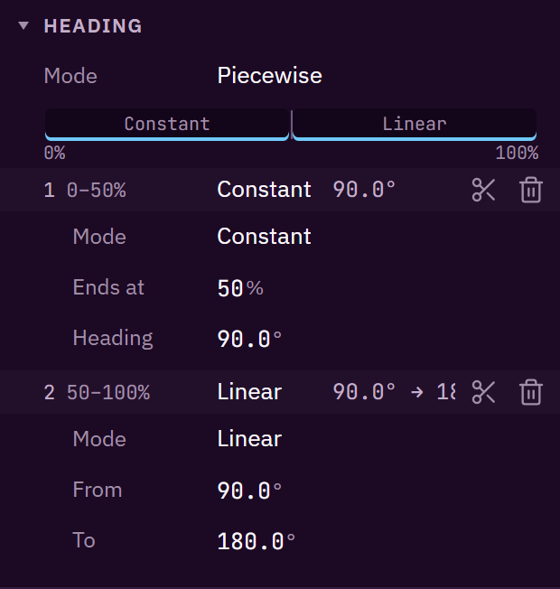

Speed
:   How fast this drive goes, as a share of the robot's top speed, when it stops early, and when it gives up. **Speed** is a percentage of that top speed; the file keeps it as a fraction (`speedFraction`). An empty Speed drives at the robot's own default from `robot.json`, which reads `80% default`, and follows it when that changes; `↑` and `↓` on the empty field step from it. The robot drives at a speed only if its `ZenithRobot` implements `atSpeed` ([robot runtime](robot-runtime.md#what-your-robot-code-provides)); the editor's times always use it. A path with a speed of its own, such as `30%`, has a reset button at the row's end, **Use the robot default, 80%**, which takes that speed out of the file again. **Stop early** picks the condition that ends the drive early, or **Never**. **Give up after** is the path's time limit (its Timeout), `Never` while it has none, the same word as Stop early: an empty one steps up from 0 with `↑`, and `↓` or a drag to the left leaves it empty, never its 0.01 s floor. In an Inspector under 300 px wide, Speed and Markers start folded, with a summary such as `80% default`.

Markers
:   The commands that fire partway along this path, one row each with its command and where it fires, such as `50% along`; point at a row for its bin. Click a row to select that marker. The **+** in the section's title, **Add marker**, puts one at the middle of the path. The Marker tool (`M`) places one where you click the path.

Marker
:   The selected marker, alone in the inspector. Placing a marker with the Marker tool, or clicking one on the field or in the Markers list, selects it. Its header is the path's id and the marker's name, `collectFlower › Marker 1`: click the path's id to select the path again, with its Markers open. Its **MARKER** section sets the command the marker fires (from `robot.json`) and that command's settings, and where it fires in one **At** row: the number, then a unit that reads `% along` (a share of the way along, kept in the file as `t` from 0 to 1, so typing 35 writes 0.35), `in from start` or `in from end`; changing the unit keeps the number. The bin in its header is **Remove marker**. A command that `robot.json` marks `stationary` shows the **Stands still** anchor in the header.

Command
:   The command to run, from the list in `robot.json`, and its settings. What the command does, from its `summary` in `robot.json`, is the hint on the **Command** row and on each option, not a paragraph; a command marked `stationary` shows the **Stands still** anchor beside its time in the header.

Stay-inside box
:   A step's envelope, shown once it has one. **Lasts at most** is how long the robot may be inside it, with the envelope's one provenance as a chip at the end of that row; **Actual** is a what-if, how long the step runs this time, to preview a run that finishes sooner or fails early: the planner times the step by it instead (the header and the timeline say `what-if`), partners still see **Lasts at most**, and the robot ignores it. It is empty, showing **Lasts at most** faintly, until you type a time no longer than that, and its bin clears it. It comes with the **Ledger** switch and only on a step its envelope times, one with no estimate of its own; one the file sets always shows, and on a step with an estimate of its own it shows greyed out, saying it is not used. **Corner** is its smallest x and y, and **Size** its width and height, in inches. The bin in the section's title removes the envelope, and Undo brings it back. A drawn envelope shows its provenance only as that chip: click it to change the label and the note, as for a point.

Wait
:   A number of seconds, or a sensor condition to wait for, never both. **Wait for** picks which, **A time** or **A condition**, and shows only that field. Switching to a time starts it at the step's Timeout, or at 0.5 s without one; switching to a condition starts with the first condition `robot.json` declares. Each switch is one undo step, and the status line says what the wait waited for before. A condition's time limit is its own row under **Until**, **Give up after** (the step's `timeoutS`); when the step has none, that row carries a warning chip, "No time limit: may wait to the end", in both description modes, and a folded **WAIT** shows a yellow dot.

Sequence
:   Steps that run one after another as a single block, listed under **STEPS** one compact row each with the kind's icon, the id and the estimate; click a row to select that step. Rest the pointer on a row for how to add steps to the group and take them out.

Parallel group
:   Steps that run at the same time. **GROUP** says how the group ends (**Mode**: all of them, any step, or a chosen step), and **STEPS** lists the group's steps, as a sequence's are. When a chosen step ends the group, **Ends with** names it, and its row in the list carries a quiet flag, "Ends the group" in its tooltip. Switching to that mode picks the group's first step that drives, or its first step when none drives, and switching back takes it out of the file. When that step leaves the group, because you drag it out or delete it, the group picks again the same way from the steps left. **Ends with** lists only the group's own steps; a disabled **Pick a step** shows only when the file names none of them, as a hand edit can leave it.

Branch
:   The condition, and the steps to run when it is true and when it is not. **Preview follows** names the side the preview takes, **If true** or **If false**, with a quiet **guess** chip when `robot.json` does not say how the ledger reads the condition; rest the pointer on the chip for why.

Transfer
:   Where the pieces come from and go to, the count the auto is written for (**Expected**) and the count the ledger uses instead (**Actual**), with a reset at the end of its row while it is set. The **Planner only** icon in the header says the robot does nothing for it. With the Ledger switch on, a closed **COUNTS** section after it shows how many pieces the ledger moves and each place's count before and after.

When nothing is selected, the inspector is the Routine view: a **Routine** header, whose `?` says to select a step or a point to edit it, then the Start and the Waypoints list.

### Optimize path

Optimize path looks for a faster route for one path step between its own two ends, and shows it
before anything changes. Start it with the wand on the toolbar, in a group of its own after the
tools, which works on the selected path step and otherwise says to select one; with **Optimize path**
in a step row's menu; or from the palette: **Optimize path** runs at once, and **Optimize path with
options…** shows the options first and waits for **Run**. Neither has a key by default. The chevron
beside the toolbar's wand, or a right-click on the wand, opens both and **Optimize every path**. Settings, Editor, Toolbar can take the wand off the
toolbar like any button. With the Optimize path switch off in Settings, General, the wand, the menu
items, the palette commands, Add a clear path here and a problem's Route around action are gone.

The card opens at the top of the inspector's column and is not a dialog: the field and the
inspector keep working beside it. It takes up to 70 % of the column; only its middle scrolls, and
the row with **Apply** and **Discard** always stays in view under it.

- **Margin** is how far the route keeps from structures, in inches. It starts at the robot's
  clearance from Settings, Robot; a change here is for this run only and is never saved. Once a
  run has started, changing it runs again 0.3 s after your last change.
- **Score with**, **Allow several paths** and **Allow heading ranges** are the options it
  remembers for you (see [Feature switches](#feature-switches)).
- **Hold start heading for** and **Hold end heading for**, in inches, are remembered too, and 0 is off.
  Hold start heading keeps the heading the robot starts with over the first so many inches of the
  route; Hold end heading makes the robot reach the path's end heading that many inches before the
  end and keep it there, so the last bit drives straight. Every route the card offers keeps them.
  When the path as written does not, the first line says so, such as "The original does not hold
  its end heading over the last 12 in, so this is the fastest route found that does: it takes the
  same time in the instant sim, to the hundredth of a second.", and that route is offered even when
  it is slower.
- While it runs, the card reads "Searching, up to 5 s" and offers **Stop**. At the time limit it
  reports the best route found so far. **Search longer** continues the search. "Stopped early" means
  you pressed **Stop**; reaching the time limit does not prove the route is the fastest possible.
- The result leads with one line, such as "0.70 s faster in the instant sim", then the step's time
  before and after in the instant sim and in the estimate. Problems the route would add are listed
  in plain words, open, and the line above **Apply** counts them in their colour, such as "Adds 1
  warning", so you see the cost before you apply. **What changes**, closed at first, has what
  changed, the closest it comes to a structure (named as the field names it, such as "the west base
  bar of the hive frame"), the markers that now fire somewhere else and notes on the run. A step
  that cannot be made faster says so. A step that goes through something with no clear way round
  says that, and the field draws the robot in red where the closest attempt falls short. A step
  whose own end is inside something says so: no route between its ends can be clear, so move the
  end first. A disabled **Apply** says why when you point at it.
- A path that goes through a structure, past the wall, into a keep-out or over the centre line, which
  the Problems panel shows as a `STRUCTURE`, `PERIMETER`, `KEEPOUT` or `OPPONENT_SIDE` problem on it,
  was never a route the robot could drive, so there is nothing to beat. Optimize path then proposes the fastest clear route it
  finds, even when it is slower, and its first line says so, such as "The original goes through the
  west base bar of the hive frame, so this is the fastest clear route found: it is 0.69 s slower in
  the estimate." When no route between the step's two ends is clear, it says that instead.
- A path with none of those problems is a route the robot can drive, so a new route must be faster,
  even where the path passes closer than the margin or rides the wall. The new route may come as
  close as the original does, and no closer, so the result is a faster route or "no faster route",
  and it never says the original goes through something the Problems panel does not show. Route
  around, below, is the exception for the margin.

A problem can start it too. On a path step, `STRUCTURE`, `CLEARANCE`, `PERIMETER`, `KEEPOUT` and
`OPPONENT_SIDE` offer **Route around** what the path goes through, and a `STRAFE_FRACTION` finding offers **Find faster
heading**. Either button selects the step, opens the card on it and runs at once. Route around is
not offered on a step whose own start or end is inside something, since no route between those ends
could be clear; **Push end clear** is the fix there. Route around
accepts a route that clears everything even if it is slower than the original, when the original
collides, as every way of starting Optimize path now does. It also does so on a `CLEARANCE` problem,
or when the path passes closer than the margin to something, which no other way of starting Optimize
path does: the route it returns keeps the whole margin, and its first line says the original comes
within the margin. Find
a faster heading keeps the path's segments exactly as written and searches the heading only. The
card's first line repeats the button's words. See [Route around](checks-and-findings.md#route-around).

The field can start it too. Right-click an empty spot and choose **Add a clear path here**: the
card, titled **Add a clear path**, opens on a new path from where the robot is (the end of the selected step, or of the routine)
to that spot, and runs at once in Route around mode, so the route goes round the structures in the
way and keeps the margin from them, even when the straight path only comes within the margin and a
longer way round is slower. With **Extend this chain** on and a path step selected, the route is added to
that step's chain as more of its paths instead of a new step; a path inside a parallel group runs
side by side with its neighbours, so it cannot be extended this way, and the status line says so
before anything runs. The path ends facing the way your
heading for new paths gives; where the spot is a legal approach to the season's current target, it
ends facing the target instead. Nothing is added until **Apply**, and when the straight path is
already clear and nothing is faster, Apply adds the straight path. Like the other entry points, it
is gone with the Optimize path switch off.

When the search finds more than one route, a row under the result reads "Route 1 of 3" with
**Previous route** and **Next route**. Routes that go round the obstacles another way come first;
every one has passed the same final check. The instant sim and the estimate do not always agree.
A route the instant sim has faster and the estimate slower is labelled "Faster in the instant sim,
slower in the estimate"; one the estimate has faster and the instant sim slower is labelled "Faster
in the estimate, slower in the instant sim". Neither is ever the first route, since the pick must
be faster in the instant sim and no slower in the estimate, but you can step to it and apply it.
A long drive that starts sideways is the usual case of the second: the estimate gains from turning
onto the path and driving nose first, while the instant sim, which follows Pedro's follower, charges
the turn made while the robot speeds up, when the turn takes the wheels' power first. The times, the clearance and the changes are for the
route shown, the field draws it, and **Apply** writes it.

On the field the proposed route is dashed in green, with a dot where one path of it meets the
next, and nothing on it can be dragged. Point at it to see the robot there. A thin line round each
structure the route passes near shows the margin.

**Apply** (`Enter`) writes the route into the step as one undo step, and the status line says how
much faster it is, such as "Optimized toOtherSide: 2.59 s → 2.48 s (instant sim).", or, for a path
that went through something, what it is now clear of, such as "Routed toOtherSide clear of the west
base bar of the hive frame: 3.18 s → 3.86 s (estimate)." **Discard**
(`Esc`) closes the card and changes nothing. Editing the auto while the card is open stops the run,
or marks its result "The auto changed. Run again.", and Apply is then replaced by **Run again**.

**Optimize every path** (the palette, or the chevron beside the toolbar's wand) runs Optimize path on
every path step of the open auto in order, each between its own two ends, and lists each step's
result: its time before and after, or "No faster route found". Its header counts the paths, such as
"7 paths". The card says which path runs now, and
**Stop** ends the whole run with the results it has; a step still going after 5 s keeps the
fastest route found so far and the next step starts. Each step with a faster route has a box,
ticked at first; the last line gives the total time the ticked ones save. A step that went through
something and now has a clear route is marked **cleared** and also has a box; its time is not
counted as a saving, and the last line says how many blocked paths the ticked ones clear. Nothing
changes until **Apply**, which writes every ticked route as one undo step, and the status line says
how many paths changed, how much faster they are in all and how many blocked paths were cleared.

## Problems panel

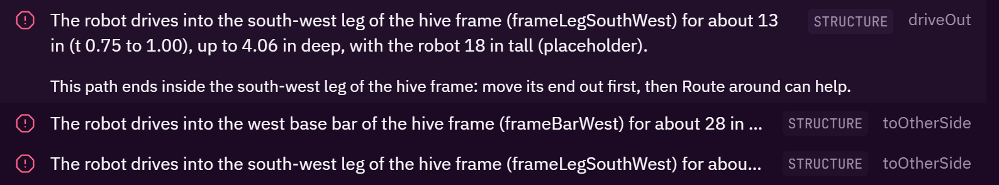

The Problems panel, below the field, lists everything Zenith noticed that could go wrong on the real field, worst first. Its header shows the counts, such as `3 errors · 5 warnings · 2 info`; click a count to show or hide that severity.

Each row has a severity icon, the message as a plain sentence, a short code (such as `PERIMETER`), and the name of the step it belongs to. A row is one line, with a long message cut short; rest the pointer on it to read all of it. Pointing at a row never moves the others.

- **Click a row** to select its step and pan the field to it. The part of the path with the problem is highlighted, the row opens to its whole message, and while that step is selected the field draws only its own clip ghosts. A problem with the start itself, such as `START_ILLEGAL`, selects the start instead, pauses playback and puts the playhead at 0.
- **Point at a row** to draw the robot where it clips. For a `STRUCTURE` row the obstacle it runs into is outlined too.
- **Hover the code** for what it means and how to fix it.
- **Fix buttons** appear on the selected row when Zenith knows the fix, in a verb and a noun, such as "Point nose along path", "Slow sweep", "Split range", "Start from robot" for a path that starts away from the robot, "Push end back" from the wall, "Push end clear" of a structure or, where two paths of a chain do not meet, "Join paths". Point at one for exactly what it does. One click applies it, and `Ctrl Z` undoes it.

When the routine is clean the panel reads "No problems found.". The time budget's note on a total that is only a bound (the `TIME_BUDGET` info) is not listed or counted here, since the timeline's estimate says the same; the check itself is unchanged, so **Validate**, Save and `zenith validate` see it as before. An auto that opens with an error or a warning gives the panel room for four rows, unless you have dragged it to a height of your own. The ghost button at the end of the header shows or hides where the robot hits the wall or a structure. The panel can be collapsed to its header, which keeps the tabs and the counts; click a tab or a count to open it again. [Checks and findings](checks-and-findings.md) lists every code.

Problems that belong to a feature you switched off in Settings, General, such as the ledger's counting problems, are not listed, and the panel ends with one line that counts the errors and warnings among them: "2 more problems in hidden features." When one of them is an error the line says so, in red ("3 more problems in hidden features, 1 of them an error."), and the header's error count says in its tooltip that hidden errors are not counted in it: a deploy still skips an auto with an error you cannot see. When every problem is hidden that way, the list reads "No problems in the features you have on." rather than "No problems found." **Show** on that line turns those switches back on. A problem that breaks a game rule always shows: with the Ledger off, a shot from a spot the rules do not allow (`LEGAL_APPROACH`) and a shot the turret cannot aim (`TURRET_RANGE`) are still listed, drawn on the field and counted in the header. The check itself always runs in full, so **Validate** (`F8`), Save and Propose see every problem whatever the switches say. See [Feature switches](#feature-switches).

## Code panel

The Code tab, beside Problems, shows Java for the open auto, kept up to date as you edit. A switch under its header picks the class. **Reference**, the default, is the class `zenith codegen` writes: a class to read, which the robot does not run. The robot runs the auto file, which builds the same routine, and a line beside the switch says so. **Export** is the OpMode `zenith codegen --export` writes: Java you paste into TeamCode and own, which runs without the auto file. It is not recommended, because Zenith no longer tracks the routine once it is exported, and the line beside the switch says that too; it needs `deploy.robotClass` in `zenith.json`. See [Exported OpMode](robot-runtime.md#exported-opmode-not-recommended). Either way the tab is read only: change the auto, not the code. Opening the tab makes the panel about 60 % of the column tall, unless you have dragged it to a height of your own, and with no step selected the code starts at `buildRoutine()`, where the routine reads from. Long comments wrap. **Copy** copies it, the selected step's lines are highlighted, and a click on a step's code selects the step. A project that names no command library gets one line that points to Settings instead, because Zenith never picks one for a team, and a project with no `codegen` section is shown the exact JSON to add. See [Robot runtime](robot-runtime.md).

## Ledger

The ledger, at the bottom of the left column, shows what the robot is holding after each step: game pieces collected and scored. On BIOBUZZ that is pollen collected from flowers and launched into hives. It is how Zenith knows a launch has something to launch and the robot is not carrying more than it can.

The ledger starts folded, showing a one-line summary (for example "4 pollen in, 3 launched"). Open it and it draws the pieces with the same glyphs as the field: pollen a gold disc, nectar a ring round a dot in its alliance's colour, each count a number and its piece.

- The strip at the top is the moment the playhead is at: **Robot** has a slot for each piece it can hold, filled with what it carries ("3/4"), and **Hive** shows the nectar already in our up cell, then a slot for each pollen it still takes to tip, filled with the pollen in it, and the number of tips so far. Nectar is heavier than pollen, so each nectar in the cell means fewer pollen to tip it: 8 pollen with none, 3 with three nectar, none at all with five. Hover the hive for what the nectar saved.
- Below it is one block per step that moved pieces: the step's name, then each movement in the same pattern, where the pieces came from, the pieces on an arrow, and where they went. A collect reads "flower 1 → 4 pollen → robot" (or red garden, or a floor quarter for pieces on the ground), a shot "robot → 4 pollen → hive", a shot that landed loose (as from outside the up cell's quarter) ends at **missed**, and a tip reads "hive tips → 4 pollen 3 nectar → floor, garden side", the floor quarter the cell dumped onto. Hover a line for the ledger's words, such as "collectFlower: collected 4 from flower1"; click it to select the step.
- With the playhead placed, the running step has the accent bar (the same step the step list highlights) and the steps still to come are drawn hollow in quieter type. While the routine plays, the list scrolls to keep the running step in view, unless you scrolled it in the last few seconds. Before playback starts every line is drawn as it is.
- **At the end** shows where the pieces lie once the auto ends: the robot, our hive with what it still needs to tip, every flower on one line, and each other place that holds a piece.

The field shows the same ledger as counts: a small badge at each hive cell, flower, garden line, floor quarter and loading zone, and a line at the top right for this robot, the partner and the loose pieces whose place is unknown. The counts are the ledger's at the playback time, so they change as the scrubber passes each step. The "Ledger counts on the field" action in the command palette hides them.

A **transfer** step tells the ledger that pieces move between two of those places when this robot does not move them, such as the partner scoring into the hive. Its inspector has From, To, Expected and Actual, and a closed Counts section: set Actual to 0 to preview the partner failing, and a branch on a condition `robot.json` says the ledger can read (such as "our hive has tipped") takes its other side in the preview. The branch's inspector names the side the preview takes. The robot does nothing for a transfer.

## Settings

The gear in the toolbar, `Ctrl ,` or **Settings** in the command palette opens the Settings window.
The sections are listed on the left, and the chosen one shows on the right. Each change applies at
once, except in Robot, which saves `robot.json` when you press **Save robot.json**. Escape or the
close button shuts it. Closing keeps an unsaved Robot change for when you come back, and while there
is one the close button's hint names the unsaved `robot.json`. On a phone it fills the
screen: pick a section from the list, and **All settings** goes back to the list.

The **Search settings** box under the title finds a setting in every section at once. Type any
words of its name, its description or one of its choices, such as `grid`, `tangent` or `dark mode`;
every word you type has to match, and the matches show under their sections' names with your words
marked, while the list of sections counts the matches in each. Choose one, with a click or `Enter`,
to open its section at that row. `Enter` in the box opens the first match, `Down` moves into the
results, `Esc` empties the box and a second `Esc` closes Settings. `Ctrl F` (`Cmd F` on a Mac)
puts the cursor in the box from anywhere in the window. Keyboard also has its own **Filter**, for
the actions and keys on that page.

Loading the bundled example says "Example loaded, read only." in the status line, with "Save makes your own copy." beside it.

While the bundled example is open, Robot and Commands show one banner, "The example is read only. Open your own project to edit these.", with an **Open project…** button to open your own; the sections themselves carry no note. General and Editor are your own, so they show none. A row's label says what it is. Command library and Pathing system keep a one-line description, and hovering any other label for a second, or pressing `Shift+F1` on its control, says more.

| Section | What it holds |
|---|---|
| Account | Your display name, how you signed in, and signing out. Shown only when Zenith has a cloud. |
| Presets | The preset your settings came from and what you changed since, the open project's presets, the built-in presets, your own presets and preset files. See [Presets](#presets). |
| General | Your feature switches. See [Feature switches](#feature-switches). |
| Robot | The open project's `robot.json`: size, clearance from field elements, speeds, drivetrain, follower, intakes and game pieces, each with its unit and its provenance on the same line as the value. A line at the top counts the values that are placeholders or still need measuring, such as "12 values are placeholders and 4 need measuring", with a switch to show only those rows. Under Follower it also holds the open project's command library and pathing system, since choosing a library writes the project's `zenith.json`; see [Choosing a command library](command-libraries.md). Read only for the example, a GitHub project, a host's robot and single files, with the reason. Closing Settings with an unsaved `robot.json` asks **Save robot.json**, **Discard** or **Keep editing**. |
| Commands | The robot's commands and their arguments: add, edit and remove them, or import them from Java. Shown only while Commands is on. |
| Editor | The theme, descriptions, finding codes, the field view, the field's grid, snapping, the heading for new paths, whether a new path starts at the previous path's end heading, how far the arrow keys, `R` and the playhead keys move, whether a measured waypoint selects before it moves, which waypoint pins the field shows, clip ghosts, overhead outlines, the clearance outline, the ledger's counts, and, while Optimize path is on, its safety margin (with **Change in Robot**, which opens the clearance) and the options its card starts with, then which buttons the toolbar shows, as a row of icon toggles. See [Toolbar buttons and finding codes](#toolbar-buttons-and-finding-codes). |
| Keyboard | Your own keys. See [Changing keys](#changing-keys). |
| Teams | The teams you are in, and the Teams panel. Shown once you are signed in. |
| Privacy and data | **Export my data** and **Delete my account**. Shown once you are signed in. |
| Admin | The admin dashboard. Shown only to Horizon admins. |

The window remembers the last section it showed, and back and forward step through the sections you
opened.

Your settings are kept in this browser, or in the desktop app, and never in a project's files,
unless you put a preset there yourself with **Add to project** ([Sharing presets with your
team](#sharing-presets-with-your-team)). Each
one is read on its own, so if one stored value is damaged, only that setting goes back, to your
preset's value for it or, when the preset does not set it, to its default, and the rest keep your
choices.

### Presets

A preset sets many settings at once. There are three built in:

| Preset | For |
|---|---|
| Basic | Draw paths, add commands, play and save, with few buttons. Step groups, Waypoints, Advanced heading, the Code tab, Ledger, Partners and finding codes are off. |
| Essential | The editor as it ships, with everything you need to plan an auto. It is what you have if you never chose a preset. |
| Full | Everything, Ledger and Partners included, and the field shows every waypoint pin, not only the open auto's. |

On your first visit, once the example has loaded, a card asks "How much of Zenith do you want to
see?" with these three presets. Essential is marked Recommended, and Skip or `Esc` chooses it.
**Import a preset file…** takes a file a teammate sent you. Your choice is applied and the core tour
starts, and the tour follows it: Basic's tour leaves out the groups and the ledger. The card shows
only on that first visit, at the plain address, so a link someone shared with you, a host's window
and a replayed tour never show it. To choose again later, use **Choose a preset…** in the help menu
or the command palette, which opens this section.

The preset your settings came from has a check and **In use** on its row, and "Applied Basic." is said
in the status line. Once you have changed something since, one line above the list says "Using Basic
(edited)". **Show changes** lists each one with what you have and what the preset has, and a **Revert**
for it; **Revert to Basic** puts every setting back. **Duplicate** is in a built-in row's "…" menu. Changes are worked out each time and never stored, so setting a value back clears its
change. Applying another preset while you have changes asks first: **Save them as a preset…**,
**Replace them** or **Cancel**. A preset never changes your layout, theme or field view, and a
built-in never changes your keys.

**Save as a preset…** keeps your settings as a preset of your own, with a name of 1 to 40
characters that is not taken (ignoring case) and not a built-in's, and an optional description. When
you have keys of your own, **Include my keys** puts them in it too; it starts off. Built-in presets
cannot be changed, but **Duplicate** makes a copy you can. Each of your presets has **Apply**,
**Rename**, **Duplicate**, **Update from current settings**, **Export…** and **Delete**, which asks
first; you can keep 20. Applying one that has keys asks whether to replace yours with them, and
deleting the one in use keeps your settings, which then read "Custom (based on Full)". Your presets
are kept in this browser apart from your other settings, under `zenith.presets`, and a damaged one is
dropped without losing the others.

**Export…** downloads `<name>.zenith-preset.json`, which carries a preset to another browser, the
desktop app or a teammate. **Import a preset file…** adds the preset in such a file to your list and
says what applying it would change, and applies nothing. A file over 64 KB, or not a preset file, is
refused; settings this version does not know are ignored and counted, a value it cannot use is left
out, a robot's setting is refused because it belongs in `robot.json`, a key you could not set
yourself is refused with the reason, and a name you already have becomes "Name (2)". A settings or
keys block that is not a list of ids is left out, and the import says so; so does a base that is not
Basic, Essential or Full, and the preset is then based on Essential.

#### Sharing presets with your team

One programmer can set Zenith up once and give the whole team the same setup through the project,
the way the team already shares its autos. Open the project's folder (in the browser or the desktop
app), and on one of your presets press **Add to project**. It is written to
`autos/presets/<name>.zenith-preset.json` (the `presets` folder inside the folder `zenith.json` names
as `autosDir`), in the same format as Export. Commit and push it with the autos; nobody's settings
change until they apply it.

Everyone who opens the project then sees it in Settings, Presets, under **This project's presets**,
with its description, the preset it is based on and whether it has keys. **Apply** asks what any
preset asks (about your changes first, then about its keys), keeps a copy in Your presets marked
"From this project.", and applies that copy. When the file changes, say after a `git pull`, the row
says "Changed in the project since you applied it.", and **Apply** brings your copy up to date
instead of adding another. Rename your copy as you like: it stays linked to its file, and **Update in project** on it updates
that file under the team's name for it. **Duplicate**
makes a copy that is yours alone.

To change a project preset, change your copy (or apply it, change settings and use **Update
"…"**), then press **Update in project**, which asks before it replaces the file; it is off while
the project's file already matches. To remove one, delete its file and commit that. The folder is
read again each time you open Settings, Presets. Zenith reads the first 20 preset files, in name
order, each with the same checks as an import, and lists a file it cannot read with the reason.
GitHub mode lists a repository's presets but does not write one: export the preset and commit it to
the folder. The example, files opened one at a time and a project another app opened have none.

### Feature switches

General has a switch for each part of Zenith that builds on pathing. They are yours, kept on this
computer, and never change a project's files. Commands starts on, because the example uses it;
partner sharing and the ledger start off; Optimize path starts on, and is off in the Basic preset.
A switch you have changed keeps your choice.

| Switch | What it adds |
|---|---|
| Partner sharing | The Partners panel, partners on the field and the timeline, the alliance problems, share files, proposals and sharing with other teams. |
| Ledger and ball counting | The Ledger panel, the counts on the field, the Transfer step, the holds at the start, and the problems the ledger finds by counting pieces: what the robot holds, what a transfer moves and where a shot lands, such as a shot with nothing loaded. A shot from a spot the rules do not allow (`LEGAL_APPROACH`) or one the turret cannot aim (`TURRET_RANGE`) is listed, drawn and counted with the switch off too. |
| Commands | Command steps, markers, parallel groups started from Insert, adding an envelope to a step (the Stay inside row in Advanced; one a step already has always shows), the command registry, **Import commands from Java…** and the problems about commands. The command library stays in Robot, under Follower, with every switch off, because the generated code needs its runtime even for an auto of paths alone. |
| Step groups | Sequence, parallel and branch groups in Insert and the palette, and **Wrap in a sequence**, **Wrap in a parallel group** and **Wrap in a branch**. **Unwrap group** stays. |
| Waypoints | **Add waypoint**, **Add a waypoint here**, **Save as waypoint…**, renaming and deleting a waypoint, and the Waypoints list in the Inspector. |
| Advanced heading | **Piecewise** in a path's heading modes, and **Split heading here** on a path that is not piecewise yet. |
| Optimize path | Finding a faster route for a path step: a card that proposes one and changes nothing until you apply it. Anyone can turn it on, and it is off only in the Basic preset. While it is on, Settings, Editor has an **Optimize path** group, described next. |
| Code tab | The Code tab beside Problems. While it is off the panel shows Problems, and it opens the tab you left once it is on again. |

Turning Ledger off hides the counting findings `CAPACITY`, `EMPTY_SHOT`, `TRANSFER` and
`LAUNCH_TARGET`. It does not hide `LEGAL_APPROACH` or `TURRET_RANGE`: those check whether the robot
can shoot from that pose, even when counting is off.

Step groups, Waypoints, Advanced heading, Optimize path and the Code tab start on. They take away
only the ways to make something, so what a file already has still shows and edits: a parallel group
stays in the step list and saves unchanged, a piecewise path keeps its full heading editor and its **Split heading
here**, and the pins your autos follow still draw and drag. The Inspector shows a quiet line on such a
step or pin, "Made with Step groups, which your settings turn off", with a button that turns the
switch on. With Waypoints off, selecting a pin shows its own row, with its numbers and provenance,
and not the list.

**Optimize path settings.** The group in Settings, Editor shows the **Safety margin**, which is the
robot's clearance from field elements: it is read from `robot.json`, 1 in until the robot sets one,
and changed in Settings, Robot, never here. Pedro's follower may drift off its path by up to the
robot's translational deviation tolerance (2.5 in unless the follower section of `robot.json` sets
another, and the row gives this robot's number), more than that default margin, so Optimize path
also checks the instant sim's own motion against the margin. The card may use another margin for
one run, which is never saved. **Score with** (the instant sim or
the estimate), **Allow several paths**, **Allow heading ranges**, **Hold start heading for** and **Hold
end heading for** (0 in, off, unless you set them) are the options the card starts with, kept for you
alone like the other settings.

Turning a switch off takes the feature out of the toolbar, the palette, the keys, the menus, the field,
the Problems panel, the tour and the help. Turning it on brings it all back at once. Two things still
point at what is off: a palette search lists its actions last and greyed, and choosing one opens this
switch, and the Problems panel counts its problems on its last line, with **Show** to turn it on. An auto that
already has command steps or markers keeps them while Commands is off: they still take their time,
are saved unchanged, and the step list says how many are hidden.

### Toolbar buttons and finding codes

Settings, Editor has two more display settings, kept with the rest and never in a project's files.
**Finding codes**, under Appearance, shows or hides the code beside each problem, such as COLLISION;
the sentence, and the fix of a selected problem, always show. **Toolbar buttons**, the last group, is one
row of icon buttons, one for each button on your toolbar, pressed while the button shows. Pressing one
takes the button away and nothing else: its key, its menu items and its
palette row still run it, and the tour skips a stop on a hidden button. Search, Settings and Help
always stay.

Hidden steps never move or vanish behind your back. **Alt+Up** and **Alt+Down** move a step past the
next step you can see, and any hidden steps it passes stay where they are. Deleting a group that holds
hidden command steps asks first, "This group also holds 2 command steps that are hidden. Delete them
too?", with **Delete all** and **Cancel**; **Undo** brings the group and everything in it back.

## Teams, sharing and partners

These parts of the editor are about working with your team and your alliance partners. This page says
what each one is and where to find it; the guides it links to say how to use it.

The account controls (**Sign in**, **Team library**, **Outbox** and the sharing chip) appear only when
Zenith has a cloud to talk to. Without one, the toolbar is exactly as described above. The Partners
panel, the alliance lanes and findings, **Import from another planner…** and proposals made from
files all work with no account and no network.

!!! note "Accounts"
    The next four sections, **Sign in**, **Team library**, the sharing chip and the share dialog, and
    **Outbox**, are in the published web app and the desktop app, for anyone who signs in
    ([Teams and sharing](teams-and-sharing.md)). A build of Zenith made from source without a cloud
    config does not show these controls.

### Sign in and your account

**Sign in**, at the right of the toolbar, is optional: it adds a team library and sharing, and
everything else works without it. Once you are signed in it shows your name and opens the
Settings window at Account, with your teams, signing out and your data in the sections beside it. See
[Signing in](teams-and-sharing.md#signing-in) and [Teams](teams-and-sharing.md#teams).

### Team library

**Team library**, in the toolbar once you are signed in, opens your team's autos and every version of
them: publish, open a version in your project, and compare or resolve two versions made from the same
one in the review view. See [The team library](teams-and-sharing.md#the-team-library).

### The sharing chip and the share dialog

The **sharing chip**, beside the auto's name, says who can see the open auto: **Team only**,
**Shared with 2 teams** or **Anyone with the link**, or **Not in the team library** before it is
published there. Hover it to see who and until when; click it to
open the **share dialog**, where you choose the teams, the level, how long, whether to include
command names (**Include command names**) and the auto's name (**Include the auto's name**), and
whether to round what they see (**Coarsen what they see**), then read the one-sentence summary and
see the auto as they will. **Share** and **Sharing**,
the page that lists every share and invite your team has made, are also toolbar buttons whenever
Zenith has a cloud (signed out, Share says to sign in first), and both are in the [command palette](#command-palette). See [Sharing outside the team](teams-and-sharing.md#sharing-outside-the-team)
and [The one-sentence summary, and See it as they will](teams-and-sharing.md#the-one-sentence-summary-and-see-it-as-they-will).

### Outbox

**Outbox**, in the toolbar once you are signed in, lists the changes made on this computer and
whether the server has them yet. With no connection an **Offline** badge shows beside it, and
publishing, sharing and proposing wait in the outbox until the connection comes back; the button
says how many are waiting. A change marked **Refused** was refused by the server and undone here; one
marked **Dropped** was dropped by signing out before the server confirmed it, and may not have reached
it. See
[Working offline](teams-and-sharing.md#working-offline).

### Partners panel

The **Partners** panel, at the bottom of the left column under the ledger, is where the alliance view
starts. **Load share file…** (or dropping share files, `.projection.json`, on the panel) adds a partner
from a file; a partner's `trajectory.json` loads the same way. **Download share file**, in the command
palette, writes a share file of the open auto for your partner to load the same way, with no
account. Signed in, shares made to your team are listed under **Shared with your team**.
Each robot has a start offset, and **Make it a wait step** turns your
own offset into a real wait. It is folded until a partner is loaded. See
[The alliance view](alliance-partners.md#the-alliance-view) and
[Load a partner's `trajectory.json`](import.md#load-a-partners-trajectoryjson).

### Alliance lanes and findings

With a partner loaded, both robots play on the field on one clock, and the [timeline](#timeline-and-playback)
gains one lane per partner under your own: its start offset as a hollow block, its phases as bars and
its envelopes hatched. Click a block to move playback to it. The predicted alliance findings get their
own group in the [Problems panel](#problems-panel), which is never counted in its totals and never
blocks a save or a deploy. A collision, a near miss or an envelope entry has two one-click fixes,
**Delay my start** and **Add a wait step**. See [The alliance view](alliance-partners.md#the-alliance-view)
and [Alliance findings](checks-and-findings.md#alliance-findings).

### New auto

**New auto**, in the Open project dialog and the command palette (search for "new"), starts a blank
auto in the open project for its robot and field, the same one `zenith new` writes. It is not saved
yet: Save writes it into the project's autos folder, or downloads it from a read-only project such as
the bundled example.

It takes the first name no auto in the project has: `new-auto`, then `new-auto-2`, and so on. In a
folder or the desktop app, Zenith lists the autos folder again first, so a file added since the
project opened counts, and once saved the new auto is in the auto picker (`Ctrl O`) and the palette.
If a file of its name appears in the folder before the first save, Save writes nothing and says so,
so it never replaces another auto.

### Download a picture

**Download picture (PNG)** and **Download picture (SVG)**, in the command palette (search for "png",
"svg", "picture" or "print"), save a picture of the open auto: its title and total time, the paths,
the markers and time-spaced footprints, the same picture [`zenith render`](cli-reference.md) writes.
It is drawn for the alliance you are viewing, with the ledger beside it when
[Ledger and ball counting](#feature-switches) is on, and without the field photograph. The files are
named `<auto>.<alliance>.png` and `<auto>.<alliance>.svg`, such as `collect-and-score.red.png`. The
PNG is twice the SVG's width, so it prints sharply. Neither changes the project.

### Saving the example, or files opened on their own

The bundled example and files opened on their own are read only, so **Save** asks where the auto
goes:

- **Full project** writes `zenith.json`, the robot, the field, the waypoints and every auto into a
  new, empty folder you choose, or downloads them as a zip where the browser has no folder picker.
  From the example, or autos opened on the example's robot and field, it is a project to try Zenith
  out in, so its `zenith.json` leaves out the example's sim command, robot class and command
  library, which name a robot repository it does not have. Files you opened on their own keep the
  `zenith.json` you opened, as it is, with its own sim command, robot class and command library;
  the desktop app is the exception, since it writes only a `zenith.json` it builds itself, the
  example's without those three. The folder must
  be empty, though hidden entries such as a `.git` folder are fine: a folder with `zenith.json` is a
  project already, and one with `TeamCode` or `build.gradle` is a robot repository, so Save writes
  nothing there and says to open it instead, which
  [sets Zenith up there](#setting-zenith-up-in-your-robot-repository). A
  folder then opens, and Save writes there from then on. When Save answers the unsaved-edits
  question before you open another of the example's autos or start a New auto, the folder opens too,
  and that auto opens from it. Before another project replaces the example, the folder stays closed,
  and the row and the status line say to open it later with **Open project**.
- **Just this auto** goes into the autos folder of a project you already have, and the row says how
  many waypoints the auto follows by name. Before it writes, Zenith reads that project's
  `waypoints.json`. When some of those waypoints are missing there, or somewhere else, a second step
  lists each with its pose here and in that project, and offers **Give these points their own
  poses** (each point that followed one of them keeps the pose it has here, and the project's
  `waypoints.json` is not changed), **Add the missing waypoints to** that file, when `zenith.json`
  names one (they go in after the waypoints already there, and no name already there changes), and
  **Follow** the project's **own** for the ones somewhere else. A waypoint counts as the same when
  the editor shows the same numbers for it in both. **Cancel** writes nothing. On `Ctrl S` that
  project then opens on the auto; when Save answered the unsaved-edits question it stays closed.
  When the auto has errors in that project, the status line says how many instead of "Saved".

Either way, the open example keeps what Save wrote, so the auto opens again with your edits. Loading
the example again starts from the bundled files.

### Setting Zenith up in your robot repository

Open your team's robot repository with **Open a folder…** (or **Set up Zenith in a robot
repository…** in the command palette). When it has no `zenith.json` yet, Zenith does not stop with
an error: it shows **Set up Zenith in** that folder, and writes nothing until you press **Set up**.

Set up reads the Java and Kotlin under `TeamCode` with the same scan as
[Import commands from Java](#import-commands-from-java), and fills in what it can:

- **Robot class**, from the class that implements `ZenithRobot`. When several do, type the one that
  is your robot; leave it empty to add it later.
- **Command library**, only from an import that names SolversLib or Ivy (the Zenith runtime's
  package for it, or the library's own). With no such import, or imports of both, it stays **Not
  chosen yet**: Zenith never picks one for you.
- `robot.json`'s commands and conditions, from the `NamedCommands` registrations it finds, each
  estimate NEEDS MEASUREMENT.

**Set up** then writes five files: `zenith.json`; `autos/robot.json`, a robot with those commands
whose numbers are all NEEDS MEASUREMENT until you measure it; `autos/waypoints.json`, with a start
waypoint; the season's field, `autos/field/biobuzz.field.json`; and one short auto,
`autos/first-auto.auto.json`. These are the files [`zenith init`](cli-reference.md#zenith-init) and
`zenith new` write. `zenith.json` has no sim command, and it has a `codegen` section only when you
gave a robot class, because every OpMode Deploy writes constructs one. Set up never writes over a
file: when any of the five is already in the folder, it says which and writes none of them, and
**Cancel** writes nothing.

If the folder already has autos but no `zenith.json`, Zenith offers **Write zenith.json** instead.
It links to the autos and nearby robot, field and waypoint files where they are. It does not move
or overwrite them. A missing robot or field file is created beside the autos. The project then opens
on its first auto. Opening a project that is already set up uses its existing `zenith.json`.

The folder then opens as your project, on `first-auto`, and Save writes there. The dialog shows the
lines to add to `build.dependencies.gradle` for the runtime and the command library you chose, with
**Copy lines**; [Robot runtime](robot-runtime.md#install) explains them. In the desktop app, Set up
works the same way: the app writes `zenith.json` itself from the library and the robot class you
chose.

### Import from another planner

**Import from another planner…**, in the Open project dialog and the command palette, opens a Pedro
Visualizer `.pp` project, a `path.json` or a `trajectory.json` as a new auto that is not saved yet,
with the importer's warnings beside the field. See [Import in the editor](import.md#import-in-the-editor).

### Import commands from Java

**Import commands from Java…**, in the command palette, fills in `robot.json`'s commands and
conditions from your robot code. It reads the `NamedCommands.register` and `registerCondition` calls
in your Java or Kotlin, in the browser, with nothing to install:

- **Scan this folder**, for a project folder opened for writing, reads the folder you name inside it
  (`zenith.json`'s `javaDir` when it is set, `TeamCode` otherwise; leave it empty for the whole
  project);
- **Scan the repository**, in GitHub mode, reads the same folder from the branch you are on, a few
  files at a time;
- **Pick a folder…** and **Pick files…** work in every browser, the desktop app included.

The dialog then lists the commands, conditions and arguments `robot.json` is missing, everything it
found that still needs a person (such as a command `robot.json` declares that the Java does not
register, or a name it could not read), and the lines of `robot.json` that would change. Nothing is
written until you press **Write robot.json**, which writes it in place in a folder opened for
writing, or **Download robot.json** anywhere else, to put in your repository and commit. Either way
the editor offers the new commands at once. New commands get an estimate of "unknown"; fill in
their summary and estimate in `robot.json`. It is the same scan as
[`zenith import-commands`](cli-reference.md#zenith-import-commands); see
[Commands from the robot's code](robot-runtime.md#commands-from-the-robots-code) for what it reads.

### Proposal mode

**Suggest changes…**, under a partner loaded from a propose-level share file, opens proposal mode:
the partner's routine drawn editable on the field, with its steps and your proposed changes on the
left and your own robot beside it. Every edit becomes a change in a proposal, never an edit of your
own auto. Commands show only as tokens such as `cmd3`, or by their names when the share file
includes them. **Save proposal…** saves it as a file. The team that owns the auto opens it with
**Open proposal…** in the command palette, in a read-only review view where it accepts or rejects
each change and applies the ones it accepts. See [Proposals](alliance-partners.md#proposals).

## Report a bug

**Help**, **Report a bug** (or search "bug" in the command palette) opens a short form: what
happened, what you expected, and the steps that make it happen again. Under it, **Sent with your
report** shows everything else the report carries, before anything goes: the Zenith version, the web
or desktop app and whether another app opened it, your browser and system by name and main version,
the window size and theme, whether accounts are on, the problems in the open auto and the names of
the last actions you ran. **Include a snapshot of my auto file**, off until you tick it, adds the
open auto as it is now, without its list of authors, up to 200 KB. If you tick it, the Horizon
admins will see that file's paths: it is the one time Horizon sees where your robot drives, and only
because you chose it. Paths on your computer become `[path]`, and no name,
email address, team or key is ever part of a report.

Reports are private. Signed out, **Copy report** puts the report on your clipboard to send to
Horizon yourself. Signed in, **Send report** sends it to
Horizon, where only the Horizon admins can read it; it is not posted anywhere public, and you cannot
read it back. The [privacy notice](privacy.md#what-we-collect-and-why) and the
[retention policy](retention.md) say how long a report is kept.

## Command palette

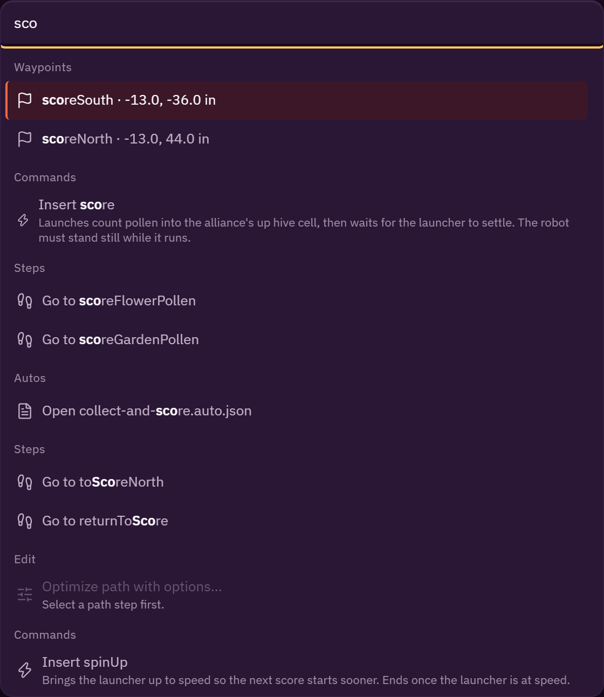

`Ctrl K` opens a search over every action, command, waypoint, step and auto in the project. Type part of a name, move with the arrow keys and press `Enter` to run it. Each result shows its shortcut, so the palette is also a way to learn them. Actions that have no button, such as switching the theme, opening robot settings or **Open the example**, are found here.

The first row is the one `Enter` runs, and a mouse resting over the list does not take it: only moving the mouse over another row does. With nothing typed, a **Recent** group leads with the last few actions you ran. Results are ordered by how well the name matches (the whole name, its start, a word in it, then anywhere in it) before the groups, and a robot command that matches only on its summary comes last and is never the row `Enter` runs, so typing `start` selects the waypoint `start`, not a command whose summary says "starts sooner". Type a step's name to get **Go to** that step, which selects it. A row that cannot run says why on a second line, and the arrow keys step over it. Choosing a waypoint selects its pin and says so on the status line, as in "Selected waypoint start (-13.0, -63.0 in)". A search with no match says "Try a step name, a waypoint, or an action."

An action that a feature switch hides still turns up when you search for it: it is listed last, greyed, under **Off in your settings**, with the switch it needs. Choosing it opens Settings, General at that switch instead of running it.

## Opened from another app

Another web app can open the editor in its own window to edit an auto for it. The first one is DSIM, the FTC driver-practice simulator: its robot builder sends the robot, the field and your autos, and the auto comes back to DSIM when you save.

In that window the toolbar names your robot and the alliance to draw for ("Draw for RED · DSIM mirrors for BLUE"), and **Save to DSIM** (`Ctrl S`) sends the auto back. When DSIM offers it, **Simulate in DSIM** runs the auto in DSIM's simulator and lays the drive it records over the plan, the same way a loaded trace is. The auto name in the title bar lists DSIM's autos and starts a new one. Opening folders, the example, GitHub and Propose are not there, because the project belongs to DSIM; the robot is read only and is changed in DSIM's robot builder.

If the window says DSIM did not send a project, close it and open it again from DSIM. If it says it was not opened from a DSIM window, the browser probably blocked the pop-up: allow pop-ups for DSIM and try again. If it says the two are out of step, reload DSIM first. The protocol the two apps speak is described in [Host mode and the `zenith-host/1` protocol](host-protocol.md).

## Keyboard reference

These are the editor's default shortcuts, from its shortcut table (`apps/web/src/app/shortcuts.ts`) and key table (`apps/web/src/app/keymap.ts`). Press `?` or `F1` in the editor for the same list, with any keys you changed, in two tabs: **Keys** lists each key once, and **Mouse** the gestures and drag modifiers. `Ctrl` is `Cmd` on a Mac.

Your saved key bindings can differ from these defaults. Open the shortcut sheet (`?`) to see the
keys active in your editor.

| Key | What it does |
|---|---|
| `V` | Select tool |
| `P` | Add path tool |
| `C` | Add command tool (on the field, with a curve point selected: make it a corner point) |
| `M` | Marker tool |
| `H` | Heading tool |
| `U` | Measure tool |
| `S` | Turn snap on or off (on the field, with a curve point selected: make it a smooth point) |
| `A` | Mirror to the other alliance |
| `F` | Zoom to the selection, or the whole routine (field focused) |
| `Enter` | Insert a step after the selected one |
| `Del` or `Backspace` | Delete the selected step (or the selected marker, or one selected path point, which keeps the chain joined; with a waypoint pin selected it opens the delete dialog, which names the autos that follow it and asks first); the status line says what went, and `Ctrl Z` brings it back |
| `Ctrl D` | Duplicate the selected step |
| `Ctrl Z` | Undo |
| `Ctrl Y` or `Ctrl Shift Z` | Redo |
| `← ↑ → ↓` | Move the selected point, start or waypoint by 0.5 in, or the Nudge setting. A held key is one undo step. On a focused step row, or any button or field in a panel, the arrows are that control's: on a row they walk the list. With no point picked, the end of the selected step moves only when it has a pose of its own, not when it follows a waypoint |
| `Shift` + arrows | Move the selected point, start or waypoint by 2 in, or the Far nudge setting |
| `F2` | Rename the selected waypoint pin |
| `R` / `Shift R` | Turn the start, a waypoint, or the heading at the selected path point (through its step's heading mode) 5° one way or the other |
| `Alt + ↑` / `Alt + ↓` | Move the selected step up or down the list, into and out of groups |
| `Alt + ←` / `Alt + →`, or the mouse's back and forward buttons | Go back or forward to the screen you were on (the open auto, and the page, sheet or dialog over it). Edits are not screens; undo stays `Ctrl Z` |
| `Space` | Play or pause, also from the scrubber and from the only selected step row or timeline block |
| `,` / `.` | Step the playhead back or forward 0.1 s, or the Playhead step setting |
| `F8` | Validate |
| `F5` | Simulate |
| `Ctrl S` | Save |
| `Ctrl Shift Enter` | Propose (open a pull request) |
| `Ctrl O` | Open project |
| `Ctrl K` | Command palette |
| `F6` | Move focus to the next panel |
| `?` or `F1` | Keyboard shortcuts and help |
| `Shift F1` | What's this: the focused control's hint, in a text field too |
| `Esc` | Cancel a drag, close a menu, clear the selection or measurement, or leave the tour |

In the desktop app, the sheet's Desktop group adds the keys its menu owns: `F10` opens the menu,
`Ctrl F5` runs the high-fidelity sim, `Ctrl Shift D` deploys, and `Ctrl Shift G` opens Commit, push
and open a pull request. The last three can be changed (see below), and the sheet shows your keys.

### Changing keys

Settings, **Keyboard** lists every action that has a key, in the shortcut sheet's groups, and a few
that have none until you give them one: Insert a path, Insert a wait, Turn on the spot, Make curve,
Make straight line, Clip ghosts and Switch theme. Its **Keys** group has the keys with no action of
their own that you can change too: Turn (`R`), Step back (`,`), Step forward (`.`) and Next panel
(`F6`). Turn takes its key without `Shift`, and `Shift` with that key still turns the other way, so
Turn on `T` makes `T` and `Shift T` turn; it needs a letter or a named key such as `F7` or `Home`,
since `Shift` turns a digit or a punctuation key into another character. A filter at the top finds
an action by its name or its key.

- Each row is an action and its key as a chip, with a short description on a long hover. A press on the
  chip waits for the new keys; press them, or `Esc` to cancel. While it waits, no other key does
  anything. An action whose feature switch is off has no row.
- If another action has those keys, Zenith asks first: **Move it here** gives them to this action and
  leaves the other with none (or with its other key, as the shortcut sheet keeps `?` when `F1`
  moves), and **Cancel** keeps both as they were. Two actions never share a key. A key of an action
  that a feature switch hides counts too, and its row says which switch hides it.
- Some keys are refused, with the reason: the browser's and the system's own (`Ctrl W`, `Ctrl T`,
  `Ctrl R`, `Ctrl C`, `F11`, `F12` and the like), `Ctrl` and `Alt` together, which type
  characters on many keyboards, the desktop app's keys, and the keys that stay fixed.
- The small **×** on a row leaves an action with no key, the reset arrow on a key you set gives it its default back, and **Reset all
  keys** asks first and then gives every action its default.
- Fixed, and listed with a lock, one row for each group of keys: `Space` for Play, `Enter` for Insert,
  Arrow keys, Alt + arrows, `Esc`, `Tab`, `F10` and the drag modifiers. `Esc` in a form or a question inside
  Settings closes that first, and the window on the next press.
- In the desktop app, a **Desktop** group lists the keys its menu owns. `F10` is fixed. The Robot
  keys (`Ctrl F5`, `Ctrl Shift D`, `Ctrl Shift G`) change like any other, and the menu follows: the
  Robot menu runs on the new key and not the old, and the File, Edit and View items show the keys
  you have given Open project, Save, Undo, Redo and the command palette. The menu itself runs a
  Robot key wherever the window has focus, so it needs `Ctrl` or `Alt`, or a function key, and
  `Alt` with a menu's letter is refused because it opens that menu. A desktop app that is too old to
  follow keys lists these rows with a lock: "Update the desktop app to change these."

A key you set shows everywhere the default did: the tooltips, the command palette, the tour and the
shortcut sheet, where it carries a small dot, and an action you left with no key is not listed there.
The sheet's **Change keys** link opens this section. A plain letter you give an action never fires
while you type in a field. Your keys are kept with your other settings in this browser, or in the
desktop app, and never in a project's files. If a later version gives an action a default key that is
already one of yours, yours wins, and the Keyboard section says once which action was left without one.

While you are typing in a field, `Ctrl Z`, `Ctrl Y` and `Ctrl D` act on the text, not the routine.
A choice list has no text to undo, so after you pick from one, `Ctrl Z` and `Ctrl Y` undo and redo
the pick in the routine straight away, while the list still has the focus.
