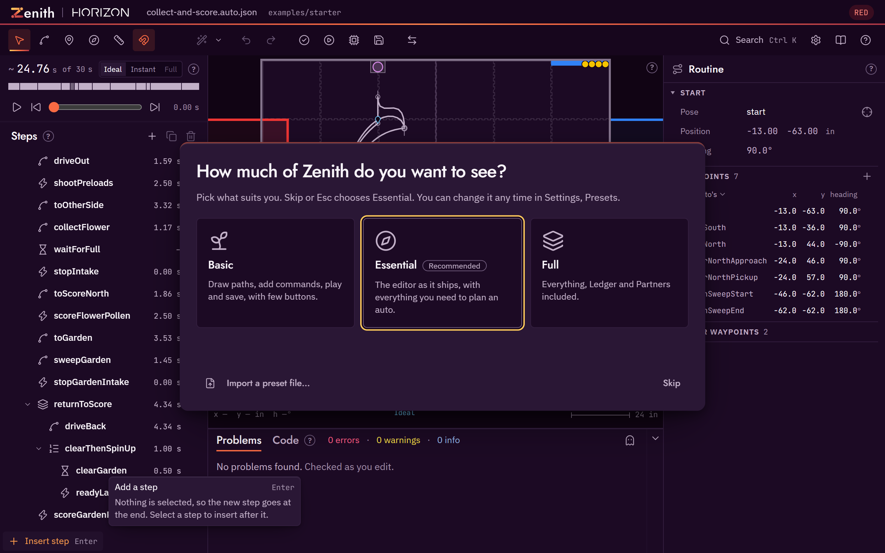
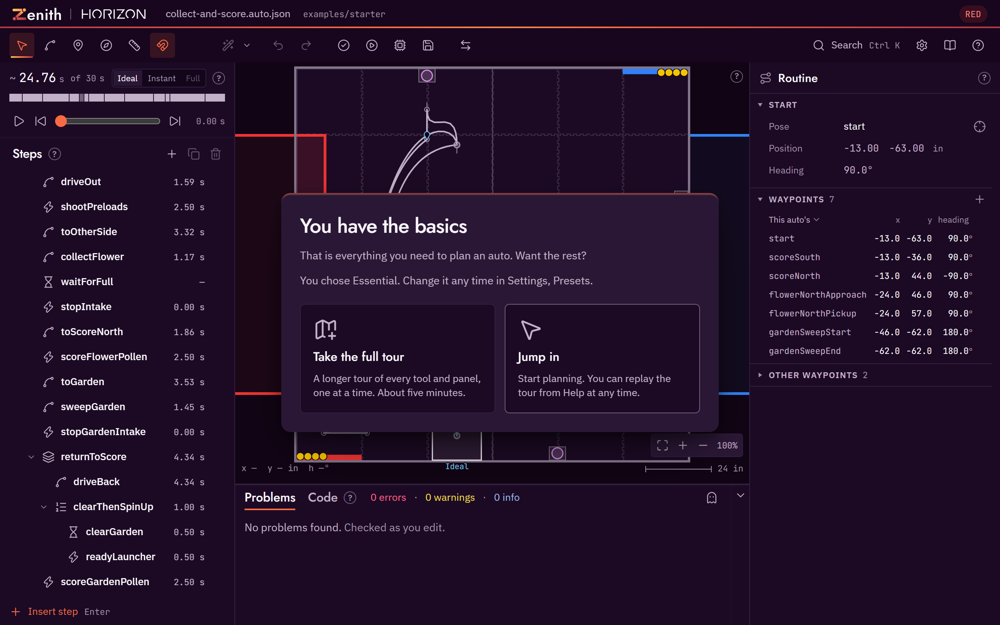
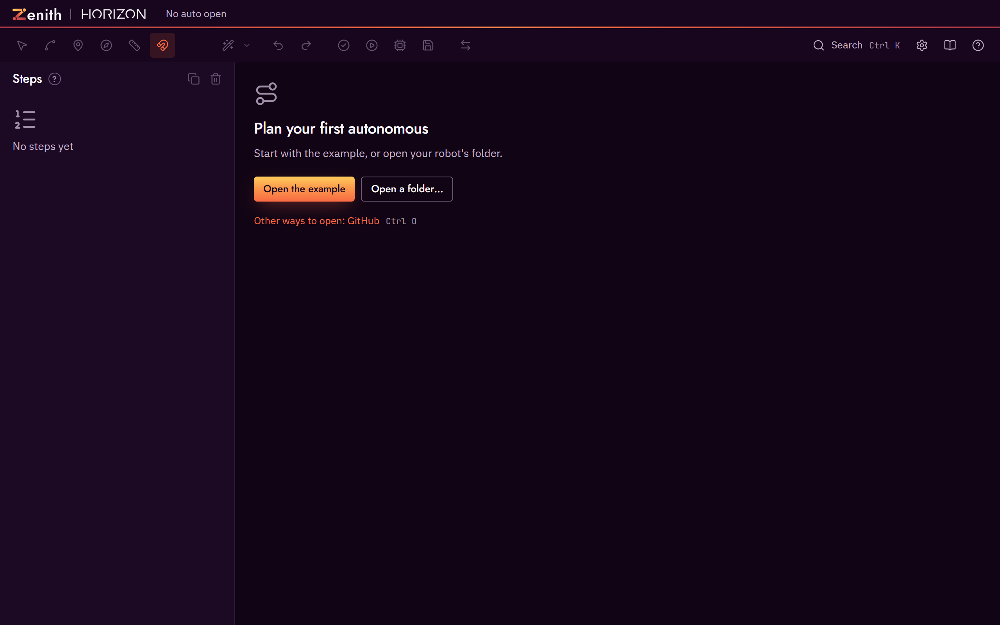

# Getting started

Open the example, take the short tour, then edit and save your first auto. You can use the Windows desktop app or the web app; both have the same editor.

| | Desktop app | Web app |
|---|---|---|
| Install | Download from GitHub Releases | None |
| Opens a robot project folder | Yes | Yes, in Chrome or Edge |
| Saves in place, reloads on outside edits | Yes | Saves in place when the browser allows it |
| High-fidelity sim, deploy, commit and pull request buttons | Yes | No |
| Platforms | Windows | Any desktop browser |

## Install the desktop app

1. Open the [Zenith releases page](https://github.com/Horizon-36596/zenith/releases) and find the newest release.
2. Download one of the two Windows files, where `<version>` is the release's version number:
    - `Zenith-Setup-<version>.exe` installs Zenith and adds it to the Start menu.
    - `Zenith-Portable-<version>.exe` runs without installing, for example from a USB stick.
3. Run the file you downloaded.

The desktop app is not code-signed yet, so the first time you run it Windows SmartScreen shows a "Windows protected your PC" dialog. Click **More info**, check that the app name reads Zenith, then click **Run anyway**. Windows remembers the choice for that file. Code signing is planned for a later release; until then this step is expected, and it is the same for every unsigned download.

!!! tip "Download only from the releases page"
    The releases page on `github.com/Horizon-36596/zenith` is the only official source for the
    installer. A copy from anywhere else may not be the same file.

Once per launch, the desktop app asks GitHub for the latest release on that page. The request has
no token and nothing about you or your autos. When a newer version is out, the status line says so
once, and **Help > Get Zenith** opens the releases page. Zenith never downloads or installs an
update by itself.

## Open the web app

Go to [zenith.horizon36596.org](https://zenith.horizon36596.org/). Editing local files needs no account or install. GitHub and team sharing have separate sign-in flows.

The web app can load the bundled example straight away. To open your own robot project folder, use a browser that supports the File System Access API, such as Chrome or Edge. In other browsers you can still load the example and download files you change.

!!! note "Your files stay on your machine"
    The web app is a static page. When you open a local folder, the browser reads and writes the files
    directly. Opening a folder does not upload it. Sharing, publishing to a team library, and
    committing through GitHub are separate actions you choose.

## The first-run tour

The first time you open each new version, a small notice says Zenith is in beta and where to report a bug: **Help**, **Report a bug**, or the [issues on GitHub](https://github.com/Horizon-36596/zenith/issues). **Got it** or `Esc` closes it for that version, and the preset card and the tour come after it. If your browser blocks site storage, it shows on every load.

On a first visit to the plain app address, with no project to reopen, Zenith loads the starter's
`collect-and-score` auto automatically. After the beta notice, choose a preset and take the tour.
A share link or a window opened by another app follows that project's flow instead.

The preset card asks "How much of Zenith do you want to see?" and offers three presets: **Basic** for a first season, **Essential** (recommended) and **Full**. Each choice says what you get. **Skip**, or `Esc` while the card has the keyboard focus, chooses Essential; **Import a preset file…** takes a file a teammate sent you. You can change your mind any time in Settings, Presets, or from **Choose a preset…** in the help menu. The card shows once, only at the plain address (a link someone shared with you does not show it), and replaying the tour never brings it back. Your choice starts the tour, which follows it: Basic's tour leaves out the groups and the ledger.

The tour highlights one part of the editor at a time. You can use the editor while it runs. Some stops ask you to try an edit, such as dragging a point. Leaving that stop restores the auto; **Undo** brings your trial edit back.

The core tour has seven stops:

1. **The field.** The FTC field from above, with the routine drawn on it. Try dragging one of the dots on the path.
2. **The steps.** The list of steps the robot runs, top to bottom. Try clicking one.
3. **Add a step.** Insert puts a new step straight after the selected one. Try adding a path.
4. **The inspector.** Every setting of the selected step: where it goes, which way the robot faces, how fast. With nothing selected it shows the routine's start and its waypoints.
5. **Waypoints.** A waypoint is a named spot measured once on the real field and saved in `waypoints.json`. Any number of autos can follow it, so moving it once moves every auto that uses it. See [Waypoints explained](editor.md#waypoints-explained).
6. **Problems.** What Zenith found that could go wrong on the real field. Click a problem to jump to its step.
7. **Play and save.** Play shows the robot running the routine; Save writes the file back; on the read-only example it asks whether to save the full project into a new, empty folder, to try Zenith out, or just this auto into a project you have. Try pressing Space.

After the core tour a card titled "You have the basics" reminds you which preset you chose ("You chose Basic. Change it any time in Settings, Presets.") and gives you a choice:

- **Take the full tour** continues with a longer tour of every feature (about five minutes): each tool, the heading arrows (with a drag to try), snapping and the drag modifiers, heading modes, markers, groups, the timeline, the ledger, where numbers come from, one-click fixes, the other alliance, simulation, sharing through GitHub, right-click menus, the command palette and the shortcut sheet.
- **Jump in** closes the tour so you can start planning. Pressing Esc on this card does the same.

Keys on a tour card, while it has the keyboard focus: `→` or `Enter` for next, `←` for back, `Esc` to skip. Anywhere else the keys are the editor's own, so `Esc` closes a menu or clears the selection. The tour starts by itself only once. Replay it at any time from the help menu (**Take the tour** or **Take the full tour**) or from the command palette (`Ctrl K`).

## Open another project

With no project open, the welcome screen says "Plan your first autonomous":

- **Open the example** loads the starter robot on the BIOBUZZ field and opens `collect-and-score`.
- **Open a folder…** opens your team's repository. If it has no `zenith.json`, Zenith offers to
  [set itself up there](editor.md#setting-zenith-up-in-your-robot-repository) before writing anything.
- **Other ways to open: GitHub** opens the project dialog. Without a folder picker, that link also
  names single files, which the dialog can load read only.

An open folder with no autos offers **New auto**. If it contains autos but none loaded, choose one
from the list; the status line identifies a file that failed to load. You can also open the example
or a folder from the command palette (`Ctrl K`) while a project is open.

## Plan a first auto

This walk-through uses `first-auto`, the smallest routine in the starter example: drive out, score the four preloaded pollen, and park. You look at each of its three steps, then delete the last one and build it again yourself, so that what you save is the same routine as the shipped `examples/starter/autos/first-auto.auto.json`. The starter robot is a plain mecanum robot with one intake at the front and a fixed launcher. Its robot dimensions and motion limits are example values, not measurements of your robot. Check each value's provenance before adapting the project.

1. **Open the example, then `first-auto`.** If you just finished the first-run tour, the example is already open. Otherwise press `Ctrl K` and choose **Open the example**. Finish the tour or press `Esc` if it starts. Press `Ctrl K`, type `first-auto` and choose **Open first-auto.auto.json**. (`Ctrl O` also lists the example's autos under "Autos in examples/starter".) The Steps panel now lists three steps, `driveOut`, `scorePreload` and `park`, and the timeline shows how long each takes against the 30 second autonomous period.
2. **Look at `driveOut`.** Click `driveOut` in the Steps panel. The inspector's **PATH** section shows a **Straight line** from the waypoint `start` to the waypoint `scoreSouth`, and the **HEADING** section's **Mode** is **Tangent** (`tangent` in the file; hover it to read what it means). The robot drives 27 in north from the south wall to a scoring spot south of the RED hive. The header reads `1.59 s` at its right, how long the plan expects it to take.
3. **Look at `scorePreload`.** Click `scorePreload`. It is a command step: **Command** `score`, with **Count** set to 4. `score` is marked stationary in the robot file, so it runs as its own step while the robot stands still. Its estimate, `0.5 + count * 0.5`, gives 2.50 s.
4. **Look at `park`.** Click `park`. In its **PATH** section, **From** reads **Last step's end** (`"current"` in the file), **To** reads the waypoint `park`, and **HEADING** is **Tangent** again, facing the way it drives. `"current"` means the path starts wherever `scorePreload` left the robot.
5. **Delete `park`.** With `park` selected, press `Del`. The routine now ends at `scoreSouth`.
6. **Add a path after `scorePreload`.** Now that nothing in `first-auto` follows the `park` waypoint, the field no longer shows its mark; the field shows only the waypoints the open auto follows. Click an empty part of the field, then in the inspector's **Waypoints** section open **Other waypoints** and click `park`: its mark shows at x −40, y −36, 27 in west of the robot. Press `P` for the Add path tool; with no step selected, the new step goes after the last one, `scorePreload`. Point at the `park` mark. With Snap on, the dashed line ends on the waypoint, a ring marks it, and the readout at the bottom left of the field says `waypoint park`. Click there. A path step named `path1` appears, its **From** already reads **Last step's end**, and the status line says "Point 1 of path1 now follows waypoint park." Press `V` to go back to the Select tool.
7. **Check that it follows the waypoint.** In the inspector's **PATH** section, **To** reads `park`. The file says `{ "ref": "park" }`, as the shipped file does, so moving the waypoint later moves this path too. If the click missed the pin, **To** reads **This pose**; pick `park` from the **To** list instead.
8. **Check the heading.** In the **HEADING** section, **Mode** reads **Linear**, the mode a new path starts with unless you chose another in Settings, Editor, **Heading for new paths**: the robot turns from the heading it arrives with to the heading it ends at. The shipped `park` uses **Tangent**, Pedro Pathing's name for facing the way it drives, with the front of the robot and its intake leading, so set **Mode** to **Tangent** to match it.
9. **Name it `park`.** Double-click `path1` in the Steps panel, type `park` and press `Enter`. Ids are how findings, the timeline and traces point at a step.
10. **Play, check and save.** Press `Space` to play. The robot drives out, stops to score, then parks. The timeline shows 5.95 s in all. Problems should read "No problems found"; click any finding to select its step and hover its code for help. Press `Ctrl S`. The example is read only, so Save asks where to put it. For this exercise, choose **Full project** and a new, empty folder. Zenith saves the robot, field, waypoints and autos together, then opens that folder; later saves write there. Without a folder picker, it downloads a zip instead. Use **Just this auto** only when you already have a Zenith project to receive it, since the auto refers to named waypoints. See [Saving the example](editor.md#saving-the-example-or-files-opened-on-their-own) for those choices. The saved auto matches the shipped steps, commands, waypoints and headings; only the deleted `park` step's note is missing.

## Next steps

- [Desktop files and recovery](desktop.md) covers saving, outside file changes, simulation, deployment
  and Git in the Windows app.
- [The editor](editor.md) covers every tool, panel, modifier and shortcut.
- [Autonomous paths, explained](paths-explained.md) explains poses, heading modes, curves, commands and markers.
- [Checks and findings](checks-and-findings.md) lists every problem Zenith can report and how to fix it.
- [Robot runtime](robot-runtime.md) shows how to run a saved auto on the robot, with Ivy or SolversLib commands. [Choosing a command library](command-libraries.md) says how to name the one your robot code uses.
